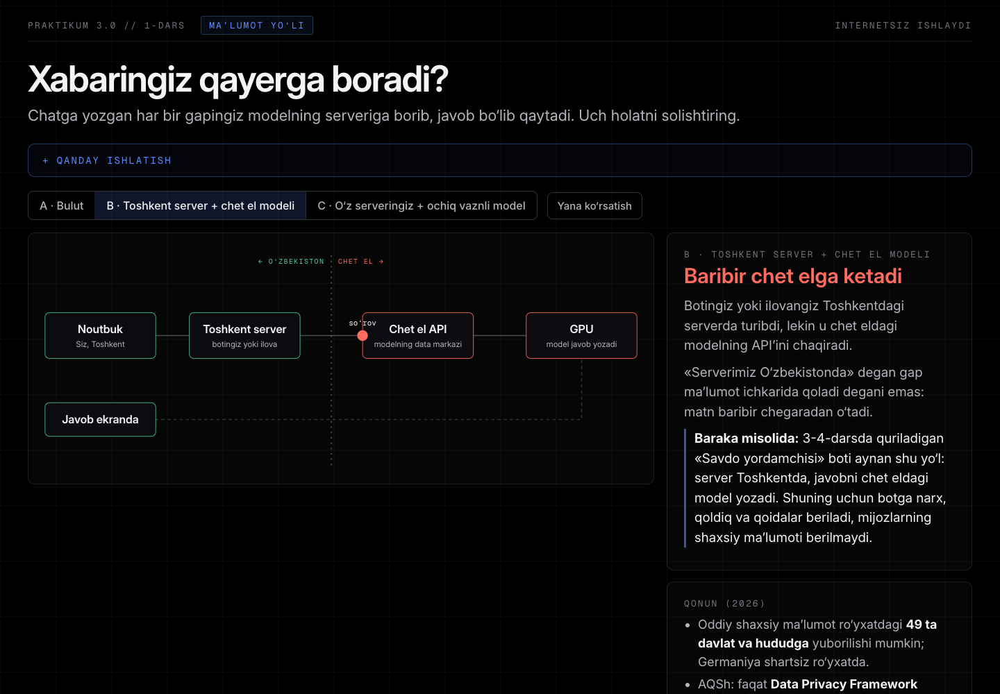

# «Xabaringiz qayerga boradi?»: qanday ishlatish

Sahifa: `index.html`, internetsiz ochiladi.

## Nima uchun

Chatga yozgan xabaringiz qaysi davlatdagi serverga borishini va qonun nima deyishini bir sahifada ko‘rasiz.
Shundan qaysi ma’lumotni AI’ga berish mumkin, qaysisini yo‘q, degan qaror chiqadi.

## Qadamlar

1. Sahifani oching.
2. A, B yoki C holatini bosing (klaviatura: 1, 2, 3).
3. Nuqtani kuzating: ko‘k nuqta O‘zbekistonda, qizil nuqta chet elda.
4. O‘ngdagi xulosani va «Baraka misolida» qatorini o‘qing.
5. Pastdagi «Qonun (2026)» va «Chatga yozishdan oldin» kartalarini o‘qing.

## Uch holat

| Holat | Yo‘l | Natija |
| --- | --- | --- |
| A · Bulut | Noutbuk → internet → AQSh yoki Yevropadagi data markaz | Ma’lumot chet elga ketadi |
| B · Toshkent server + chet el modeli | Noutbuk → Toshkentdagi server → chet el API | Baribir chet elga ketadi |
| C · O‘z serveringiz + ochiq vaznli model | Noutbuk → sizning server, model ichida | Ma’lumot ichkarida qoladi |

## Namuna: Baraka Office

3-4-darsda quriladigan «Savdo yordamchisi» boti B holati: server Toshkentda, javobni chet eldagi model yozadi.
Shuning uchun botga narxlar, qoldiq va qoidalar beriladi, mijozlarning shaxsiy ma’lumoti berilmaydi.

## Qonun qisqacha (2026)

- Oddiy shaxsiy ma’lumot ro‘yxatdagi 49 ta davlat va hududga yuborilishi mumkin; Germaniya shartsiz ro‘yxatda (VM qarori 415).
- AQSh faqat Data Privacy Framework sertifikati bor kompaniyalar uchun; Anthropic (Claude) siyosatida DPF ko‘rsatilmagan.
- Biometrik, genetik ma’lumot va aloqa abonentlari ma’lumoti faqat O‘zbekistonda (ZRU-1125).
- Xodim ma’lumoti AI xizmatiga faqat yozma rozilik bilan (Mehnat kodeksi, 178-modda).
- AI bilan noqonuniy ishlov: 22-44 mln so‘m jarima (MJtK 46-2-modda).

Bu yuridik maslahat emas: kompaniyangiz bunga tayanishdan oldin yurist tasdiqlashi kerak.

## Ko‘p uchraydigan xatolar

- «Serverimiz Toshkentda, demak ma’lumot ichkarida» deb o‘ylash: model chet elda bo‘lsa, B holati.
- «DeepSeek ochiq model, demak sayti ham maxfiy» deb o‘ylash: saytdagi chat ma’lumotni Xitoyda saqlaydi.

## Tayyor

Chatga mijoz ma’lumotini yozishdan oldin uch savol berasiz: kerakmi, ismsiz bo‘ladimi, odam rozimi.
