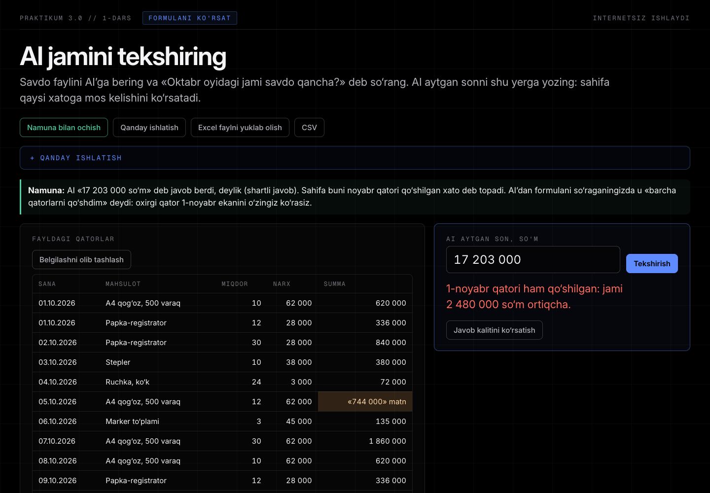

# «Formulani ko‘rsat»: qanday ishlatish

Sahifa: `index.html`, internetsiz ochiladi.
Fayllar: `savdo-oktabr.xlsx` va `savdo-oktabr.csv` (shartli do‘kon savdosi, 35 qator).

## Nima uchun

AI hisobda xato qilsa ham ishonch bilan javob beradi, Excel kabi qizil katak ko‘rsatmaydi.
Bu mashq AI’ning sonini tekshirishni va «formulangni ko‘rsat» deb so‘rashni o‘rgatadi.

## Boshlashdan oldin kerak

- savdo-oktabr.xlsx fayli (sahifadagi tugma yoki mentor beradi).
- Claude yoki boshqa AI chat.

## Qadamlar

1. Faylni AI chatga yuklang.
2. So‘rang: «Oktabr oyidagi jami savdo qancha?»
3. AI aytgan sonni sahifadagi «AI aytgan son» qutisiga yozing va «Tekshirish»ni bosing.
4. AI’dan so‘rang: «Qanday hisobladingiz? Formulani va qaysi qatorlarni qo‘shganingizni ko‘rsat.»
5. «Tuzoqlarni belgilash» tugmasi bilan jadvaldagi muammoli qatorlarni ko‘ring.

## Faylda nima bor

- 34 ta oktabr savdosi va 1-noyabrdagi bitta savdo (oxirgi qator).
- 3 ta summa Telegram’dan nusxalangandek matn bo‘lib yozilgan («744 000»): Excel SUM ularni qo‘shmaydi.

## Natijani qanday o‘qish

| Rang | Ma’nosi |
| --- | --- |
| Yashil | Son to‘g‘ri: 34 ta oktabr qatori, matnli summalar ham hisobda |
| Qizil | Ma’lum xato: matnli summalar tushib qolgan yoki noyabr qo‘shilgan; sababi yoziladi |
| Kulrang | Boshqa xato: farq yoziladi, AI’dan formulani so‘rang |

## Namuna

«Namuna bilan ochish» tugmasi AI «17 203 000 so‘m» deb javob bergan holatni ko‘rsatadi (shartli javob).

Sahifa: «1-noyabr qatori ham qo‘shilgan: jami 2 480 000 so‘m ortiqcha».
To‘g‘ri oktabr jami 14 723 000 so‘m.
Excel’da butun ustunga =SUM qilsangiz, 16 270 000 chiqadi: u ham xato, chunki 3 ta matnli summani tashlab, noyabrni qo‘shadi.

**Qanday o‘qish:** AI ham, Excel ham noto‘g‘ri bo‘lishi mumkin.
Farqi: so‘rasangiz, AI qanday hisoblaganini aytadi; siz qaysi qatorlarni olganini tekshirasiz.

## Ko‘p uchraydigan xatolar

- Birinchi javobni tekshirmasdan hisobotga qo‘yish.
- «To‘g‘rimi?» deb so‘rash: AI odatda «ha» deydi. «Qaysi qatorlarni qo‘shding?» deb so‘rang.
- Sanaga qaramaslik: oy oxiridagi va boshidagi qatorlar aralashib ketadi.

## Tayyor

AI’ning soni qaysi qatorlardan chiqqanini va qayerda adashganini tushuntira olasiz.
