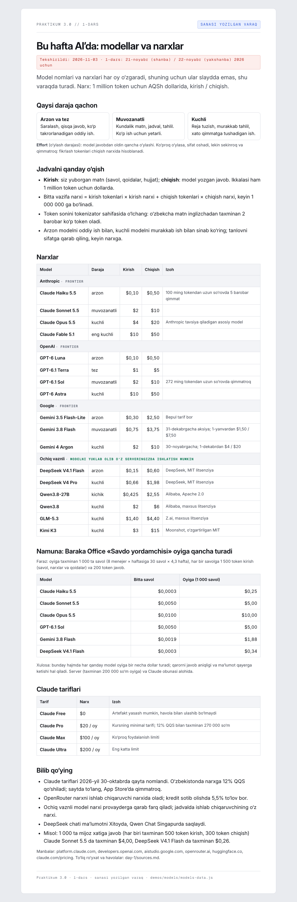

# «Bu hafta AI’da» varag‘i: qanday o‘qish

Sahifa: `index.html` (ekranda) va `handouts/pdf/bu-hafta-ai-da.pdf` (bosma).
Narxlar har oy o‘zgaradi: varaqdagi «Tekshirildi» sanasiga qarang.

## Nima uchun

Model tanlash va xarajatni hisoblash uchun bitta sanasi yozilgan jadval.
Model nomlari va narxlari slaydlarda emas, shu yerda turadi.

## Qadamlar

1. Ishingiz qaysi darajaga to‘g‘ri kelishini tanlang: arzon va tez, muvozanatli yoki kuchli.
2. Jadvaldan o‘sha darajadagi modelning kirish va chiqish narxini oling.
3. Bitta vazifaning tokenlarini tokenizator sahifasida o‘lchang.
4. Hisoblang: bitta vazifa narxi = (kirish tokenlari × kirish narxi + chiqish tokenlari × chiqish narxi) / 1 000 000.
5. Oylik narx = bitta vazifa narxi × oyiga necha marta.

## Har bir ustun nima

| Ustun | Nima |
| --- | --- |
| Daraja | Arzon, muvozanatli, kuchli: ish murakkabligiga qarab |
| Kirish | Siz yuborgan matnning narxi, 1 million token uchun dollar |
| Chiqish | Model yozgan javobning narxi; odatda kirishdan bir necha barobar qimmat |
| Izoh | Muddatli aksiya, litsenziya yoki shart |

## Namuna: Baraka Office «Savdo yordamchisi»

Faraz: oyiga taxminan 1 000 savol (8 menejer × haftasiga 30 savol × 4,3 hafta), har biriga 1 500 token kirish va 200 token javob.

| Model | Bitta savol | Oyiga |
| --- | --- | --- |
| Claude Haiku 5.5 | (1 500 × 0,10 + 200 × 0,50) / 1 000 000 = 0,00025 $ | 0,25 $ |
| Claude Sonnet 5.5 | (1 500 × 2 + 200 × 10) / 1 000 000 = 0,005 $ | 5,00 $ |
| Claude Opus 5.5 | (1 500 × 4 + 200 × 20) / 1 000 000 = 0,01 $ | 10,00 $ |
| DeepSeek V4.1 Flash | (1 500 × 0,15 + 200 × 0,60) / 1 000 000 = 0,000345 $ | 0,34 $ |

**Qanday o‘qish:** bu hajmda har qanday model oyiga bir necha dollar.
Qarorni javob aniqligi va ma’lumot qayerga ketishi hal qiladi, narx emas.
Server (oyiga taxminan 200 000 so‘m) va Claude obunasi alohida.

## Ko‘p uchraydigan xatolar

- Faqat kirish narxiga qarash: javob uzun bo‘lsa, chiqish narxi ko‘p bo‘ladi.
- Eski varaqdan foydalanish: narx oyda bir necha marta o‘zgaradi.
- O‘zbekcha matnni inglizcha bilan bir xil hisoblash: o‘zbekcha taxminan 2 barobar ko‘p token.

## Tayyor

Bitta vazifangizning oylik narxini uchta model uchun hisoblab, birini sababi bilan tanlay olasiz.
