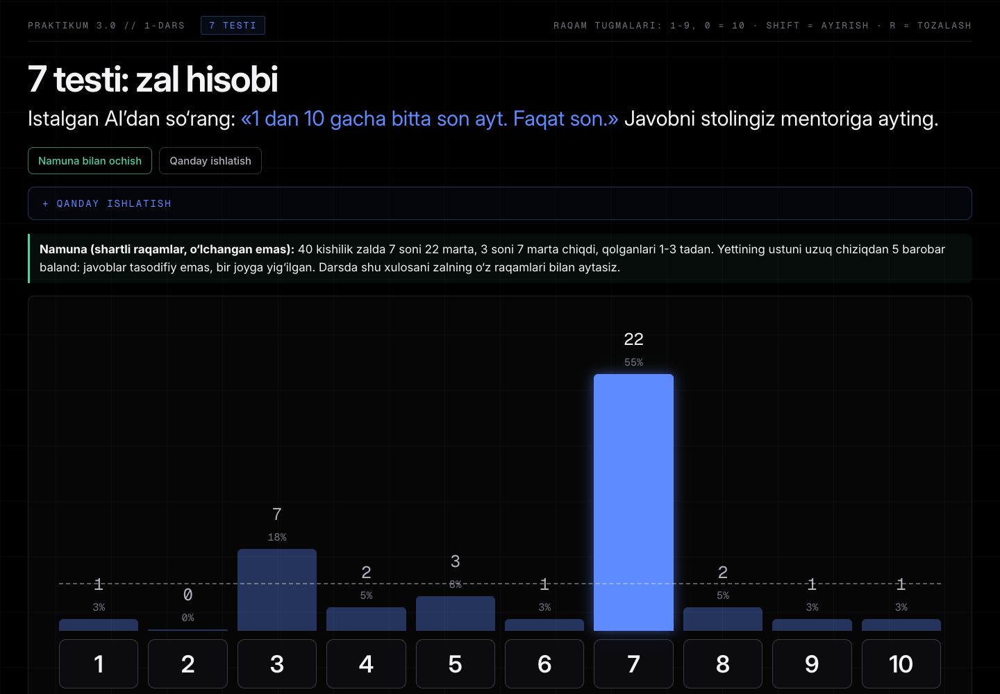

# 7 testi: qanday ishlatish

Sahifa: `index.html`, internetsiz ochiladi.
Darsda instruktor va mentorlar ishlatadi; uyda oilangiz yoki jamoangiz bilan qaytarish mumkin.

## Nima uchun

Hamma bir xil savolni AI’ga beradi va javoblar bir-ikki songa yig‘ilganini ko‘radi.
Bu «model tanlamaydi, eng ehtimolli javobni taxmin qiladi» degan fikrni o‘z ko‘zingiz bilan ko‘rsatadi.

## Boshlashdan oldin kerak

- Har kimda telefon yoki noutbukda istalgan AI chat.
- Har stolda bitta sanovchi (darsda mentor).

## Qadamlar

1. Sahifani oching va R tugmasi bilan tozalang.
2. Hamma so‘raydi: «1 dan 10 gacha bitta son ayt. Faqat son.»
3. Sanovchi stolidagi javoblarni aytadi: «7 soni 4 ta, 3 soni 1 ta».
4. Har javobni bosing: sonli tugma yoki klaviatura (0 = 10, Shift bilan ayiradi, Backspace oxirgisini bekor qiladi).

## Natijani qanday o‘qish

- **Uzuq chiziq**: agar javoblar tasodifiy bo‘lganda, har bir son shu balandlikda bo‘lardi (10%).
- **Baland ustun**: ko‘p model bir xil javob beradi; bu taxmin, tanlov emas.

## Namuna

«Namuna bilan ochish» shartli raqamlarni qo‘yadi (o‘lchangan emas): 40 javobdan 22 tasi 7, 7 tasi 3.

Yettining ustuni uzuq chiziqdan 5 barobar baland: javoblar bir joyga yig‘ilgan.
Darsda xulosani zalning o‘z raqamlari bilan aytasiz.

## Ko‘p uchraydigan xatolar

- Bir odamning javobini ikki marta sanash.
- «Har doim 7 chiqadi» deb va’da qilish: ba’zan 3 yoki 5 ko‘p chiqadi; muhimi, javoblar bir joyga yig‘iladi.

## Tayyor

«Model son tanlamaydi, taxmin qiladi: shuning uchun uning raqamini tekshiraman» deb ayta olasiz.
