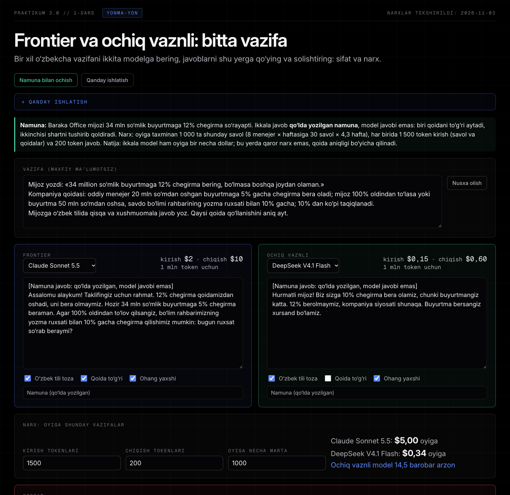

# Frontier va ochiq vaznli: qanday ishlatish

Sahifa: `index.html`, internetsiz ochiladi; javoblarni olish uchun esa Claude va ochiq vaznli chat kerak.

## Nima uchun

Bitta vazifani ikki xil modelga berib, javob sifatini va oylik narxni yonma-yon ko‘rasiz.
Shundan har bir ish uchun «qaysi model va nega» degan qaror chiqadi.

## Boshlashdan oldin kerak

- Maxfiy bo‘lmagan bitta biznes vazifasi: mijozga javob yoki qoida bo‘yicha savol.
- Kompaniya qoidasi matni (prays-list, chegirma tartibi, shartnoma bandi).
- Claude va bitta ochiq vaznli chat: chat.deepseek.com yoki chat.qwen.ai.
- Bu savol oyiga necha marta berilishi: To‘plam 1 dagi B shaklining B.2 ustuni (haftasiga) × 4,3.

## Qadamlar

1. «Vazifa» qutisiga savolni va qoidani yozing, «Nusxa olish»ni bosing.
2. Uni Claude’ga va ochiq vaznli chatga yuboring.
3. Ikkala javobni o‘z qutisiga qo‘ying va model nomini tanlang.
4. Har javobga uchta belgi qo‘ying: til toza, qoida to‘g‘ri, ohang yaxshi.
5. Pastda kirish va chiqish tokenlarini, oyiga necha marta ekanini yozing.

## Har bir maydon nima

| Maydon | Nima | Qayerdan |
| --- | --- | --- |
| Kirish tokenlari | Savol va unga qo‘shilgan qoidalar uzunligi | Tokenizator sahifasida o‘lchang |
| Chiqish tokenlari | Javob uzunligi | Javobni tokenizatorga qo‘ying |
| Oyiga necha marta | Shu savol oyiga necha marta beriladi | B shakli, B.2 × 4,3 |
| Narx | 1 million token uchun dollar | Sanasi yozilgan varaq (models-data.js) |

## Namuna: Baraka Office

«Namuna bilan ochish» tugmasi Baraka Office mijozining 34 mln so‘mlik buyurtmaga 12% chegirma so‘rashini qo‘yadi.
Ikkala javob **qo‘lda yozilgan namuna**, model javobi emas: usulni ko‘rsatish uchun.

- Chap javob qoidani to‘g‘ri aytadi: hozir 5%, 100% oldindan to‘lovda rahbar ruxsati bilan 10%.
- O‘ng javob «10% bera olamiz» deydi, lekin shartni (rahbar ruxsati va 100% to‘lov) tushirib qoldiradi: «Qoida to‘g‘ri» belgisi qo‘yilmagan.
- Narx: oyiga taxminan 1 000 savol (8 menejer × haftasiga 30 savol × 4,3 hafta), 1 500 token kirish, 200 token javob.
  Claude Sonnet 5.5: oyiga 5,00 dollar; DeepSeek V4.1 Flash: 0,34 dollar; farq 14,5 barobar.

**Qanday o‘qish:** ikkala narx ham kichik, shuning uchun qarorni javob aniqligi hal qiladi.
Qoidani noto‘g‘ri aytadigan model bitta noto‘g‘ri chegirma bilan oylik farqdan ko‘p zarar keltiradi.

## Ko‘p uchraydigan xatolar

- Mijoz ma’lumotini DeepSeek saytiga yozish: u ma’lumotni Xitoyda saqlaydi.
- Faqat narxga qarab tanlash.
- Har xil vazifani solishtirish: ikkala modelga aynan bir xil matn bering.

## Tayyor

Har bir vazifa uchun bir gap yoza olasiz: «Bu ishga [model], chunki [sifat yoki narx sababi]».
