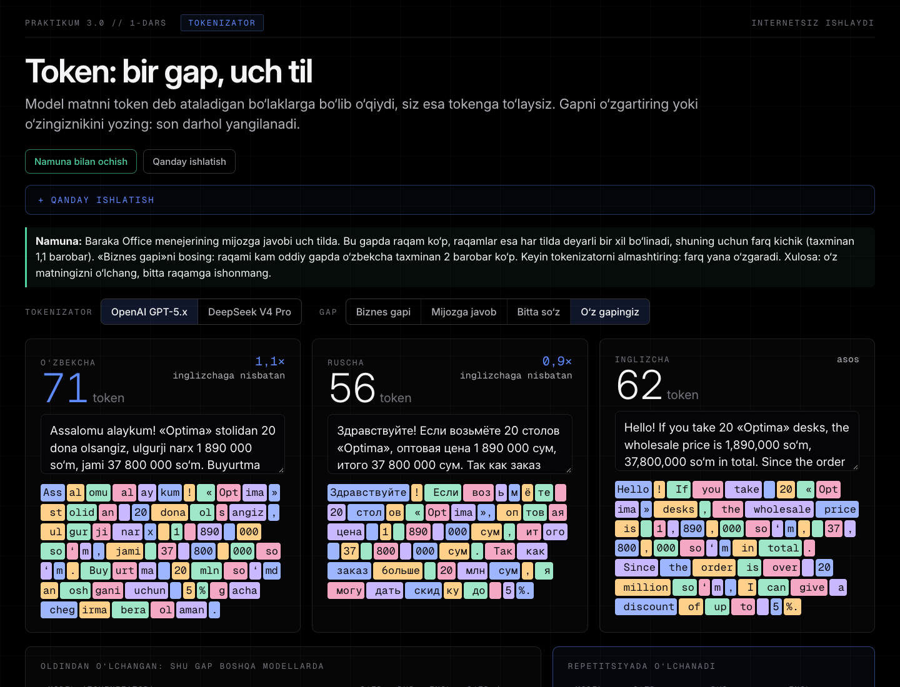

# Tokenizator: qanday ishlatish

Sahifa: `index.html` (papkadan ochiladi) yoki `tokenizer-offline.html` (bitta fayl, Telegram orqali yuboriladi).
Ikkalasi ham internetsiz ishlaydi.

## Nima uchun

Model matnni token deb ataladigan bo‘laklarga bo‘lib o‘qiydi va narx tokenda hisoblanadi.
Sahifa bir xil gap o‘zbek, rus va ingliz tilida necha tokenga bo‘linishini ko‘rsatadi.
Shundan o‘zbekcha so‘rovlaringiz qancha qimmat va suhbat oynasini qancha tez to‘ldirishini bilasiz.

## Boshlashdan oldin kerak

- Sahifa fayli (mentor stol chatiga tashlaydi).
- Biznesingizdan bitta gap: mijozga yozadigan javob, xodimga topshiriq yoki narx haqida xabar.
- O‘sha gapning rus va ingliz tilidagi tarjimasi (Claude’dan so‘rasangiz bo‘ladi).

## Qadamlar

1. Faylni brauzerda oching.
2. «Tokenizator» qatoridan birini tanlang: «OpenAI GPT-5.x» yoki «DeepSeek V4 Pro».
3. «Gap» qatoridan «O‘z gapingiz»ni bosing.
4. Gapingizni o‘zbekcha qutiga, tarjimasini rus va ingliz qutilariga yozing.
5. Har qutidagi katta sonni yozib oling.
6. Tokenizatorni almashtiring va sonlar qanday o‘zgarishini ko‘ring.

## Har bir maydon nima

| Joy | Nima | Qayerdan |
| --- | --- | --- |
| Katta son | Gap necha tokenga bo‘lindi | Sahifa hisoblaydi |
| «1,8×» | Inglizchadan necha barobar ko‘p | Sahifa hisoblaydi |
| Rangli bo‘laklar | Model ko‘radigan bo‘laklar | Sahifa ko‘rsatadi |
| Pastdagi jadval | Shu gap 7 ta modelda (3-noyabrda o‘lchangan) | Oldindan o‘lchangan |
| Claude va Gemini qutilari | Instruktor repetitsiyada yozadigan sonlar | API orqali o‘lchanadi |

## Namuna: Baraka Office

«Namuna bilan ochish» tugmasi Baraka Office menejerining mijozga javobini uch tilda qo‘yadi.

Natija (OpenAI GPT-5.x): o‘zbekcha 71, ruscha 56, inglizcha 62 token, ya’ni o‘zbekcha atigi 1,1 barobar ko‘p.
Sababi: gapda raqam ko‘p («1 890 000», «37 800 000»), raqamlar esa har tilda deyarli bir xil bo‘linadi.
Endi «Biznes gapi»ni bosing: raqami kam oddiy gapda o‘zbekcha 44, inglizcha 24 token, ya’ni 1,8 barobar.
DeepSeek V4 Pro modelida xuddi shu gap 48 va 24 token: 2,0 barobar.

**Qanday o‘qish:** o‘zbekcha matn oddiy gapda taxminan 2 barobar ko‘p token oladi, raqamli xabarda farq kichikroq.
Shuning uchun bitta umumiy raqamga ishonmang: o‘z matningizni o‘lchang.

## Ko‘p uchraydigan xatolar

- Uch qutiga har xil ma’noli gap yozish: solishtirib bo‘lmaydi.
- Bitta so‘zdan xulosa qilish: «o‘quvchi» 5 token, «student» 1 token, lekin butun gapda farq 2 barobar atrofida.
- Apostrofni hisobga olmaslik: «o‘» dagi belgi ko‘pincha alohida bo‘lak bo‘ladi.

## Tayyor

«Mening gapim o‘zbekchada X token, inglizchada Y token, ya’ni Z barobar» deb ayta olasiz.
