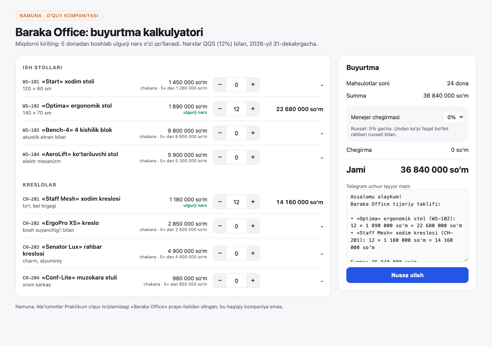

# Birinchi qurilish: qanday ishlatish

Varaq: `prompt-sheet.html` (ekranda, nusxa olish tugmalari bilan) yoki `prompt-sheet.pdf` (bosma).
Natija: o‘z biznesingiz uchun narx kalkulyatori yoki bir sahifalik taklif, Claude chatida ishlaydigan sahifa (artefakt).

## Boshlashdan oldin kerak

- Claude Pro (tayyorgarlik darsida ulangan) va claude.ai brauzerda ochiq.
- Settings → Capabilities bo‘limida «Code execution and file creation» yoqilgan.
- 3-5 ta mahsulot yoki xizmat va ularning hozirgi narxi.
  Qayerdan: amaldagi prays-listingiz, 1C yoki Excel’dagi narxlar jadvali; bilmasangiz, savdo bo‘limi boshlig‘idan so‘rang.
- Narx qoidasi, agar bo‘lsa: ulgurji narx necha donadan, chegirma qachon beriladi, yetkazish narxi.

## Qadamlar

1. Varaqdan biznes turingizga eng yaqin promptni toping (8 ta tur va bo‘sh shablon bor).
2. «Nusxa olish»ni bosing va Claude chatiga qo‘ying.
3. Kvadrat qavsdagi har bir joyni o‘z ma’lumotingiz bilan almashtiring.
4. Yuboring va natijani sinang: miqdorni o‘zgartiring, jami to‘g‘ri chiqyaptimi?
5. Chatda bitta narsani o‘zgartirishni so‘rang, keyin yana ikkitasini.

## Har bir joy nima

| Joy | Nima yoziladi | Misol |
| --- | --- | --- |
| [biznes turi] | Nima sotasiz yoki ishlab chiqarasiz | ofis mebeli |
| [mahsulot], [narx] | Prays-listdagi nom va so‘mdagi narx | «Optima» stol, 1 890 000 |
| [chegirma qoidasi] | Qachon va qancha chegirma | 20 mln so‘mdan oshsa, 5% gacha |
| [ulgurji narx] | Necha donadan arzonroq narx | 5 donadan 1 890 000 |
| Telegram matni | Mijozga yuboriladigan tayyor xabar | Claude o‘zi yozadi |

## Namuna: Baraka Office

7-prompt (ishlab chiqarish) Baraka Office prays-listi bilan to‘ldirilgan:

```text
Men Toshkentda ofis mebeli ishlab chiqaraman.
Dilerlar va korporativ mijozlar uchun buyurtma kalkulyatori kerak, uni artefakt qilib yasab ber.

Mahsulotlar (kodi, nomi, chakana narx 1-4 dona, ulgurji narx 5+ dona, so‘mda):
- WS-101, «Start» xodim stoli, 1 450 000, 1 280 000
- WS-102, «Optima» ergonomik stol, 2 150 000, 1 890 000
- WS-103, «Bench-4» 4 kishilik blok, 9 800 000, 8 600 000
- WS-104, «AeroLift» ko‘tariluvchi stol, 5 900 000, 5 300 000
- CH-201, «Staff Mesh» xodim kreslosi, 1 350 000, 1 180 000
- CH-202, «ErgoPro X5» kreslo, 2 850 000, 2 500 000
- CH-203, «Senator Lux» rahbar kreslosi, 4 900 000, 4 400 000
- CH-204, «Conf-Lite» muzokara stuli, 980 000, 850 000

Qoidalar: 5 donadan boshlab ulgurji narx o‘zi qo‘llansin.
Buyurtma 20 000 000 so‘mdan oshsa, menejer 5% gacha chegirma tanlay olsin, undan kam bo‘lsa chegirma yopiq tursin.
Mijoz miqdorlarni kiritsin; har bir qator, chegirma va jami chiqsin.
Pastda Telegram uchun tijoriy taklif matni va «Nusxa olish» tugmasi bo‘lsin.
Barcha yozuvlar o‘zbek tilida bo‘lsin.
```

Natija (namuna, `examples/namuna-kalkulyator.html`):



**Natijani qanday tekshirish:**

- «Optima»dan 12 dona: narx o‘zi 1 890 000 ga tushdi (ulgurji), qator 12 × 1 890 000 = 22 680 000.
- Jami 20 mln dan oshgach, «Menejer chegirmasi» ochildi; undan kam bo‘lsa yopiq: qoida ishlayapti.
- Telegram matnidagi summa jami bilan bir xil.

Boshqa ikkita namuna: `examples/namuna-banket.html` (restoran, 5-prompt) va `examples/namuna-taklif.html` (o‘quv markazi, 4-prompt).

## Yomon misol va uning to‘g‘ri varianti

**Yomon:**

```text
Menga kalkulyator qilib ber.
```

**Nima noto‘g‘ri:** Claude sizning mahsulotingizni, narxingizni va qoidangizni bilmaydi.
U umumiy namuna yasaydi yoki savol beradi; natija sizning biznesingizda ishlamaydi.

**To‘g‘ri:** varaqdagi promptni oling va har bir kvadrat qavsni to‘ldiring (yuqoridagi namunadek).
Nima yozishni bilmasangiz, «Qotib qoldingizmi?» promptini yuboring: Claude avval 3 ta savol beradi, keyin quradi.

## Ko‘p uchraydigan xatolar

- Mijoz ismi, telefoni yoki hisob raqamini yozish: faqat mahsulot va narx kerak.
- Narxni «1.250.000» yoki «1,25 mln» kabi aralash yozish: bitta ko‘rinishda yozing, masalan «1 250 000».
- Bir vaqtda beshta o‘zgarish so‘rash: har safar bittasini so‘rang.
- Artefakt chiqmasa, sozlamani tekshirmaslik: Settings → Capabilities → «Code execution and file creation».

## Tayyor

- Kalkulyator yoki taklif sizning real mahsulot va narxlaringiz bilan ishlaydi.
- Chat orqali kamida bitta narsa o‘zgartirilgan.
