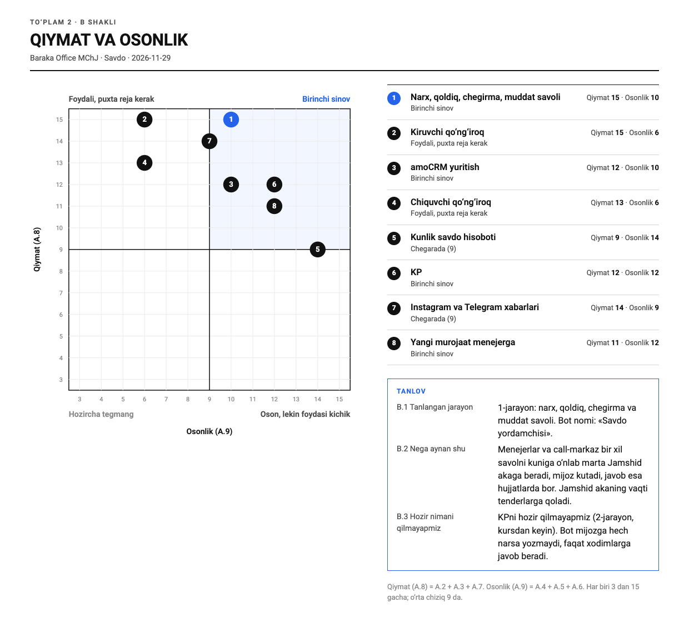

# 2-dars mashqlari

Sakkizta mashq, darsdagi tartibda. Manba: day-2/exercises/0*.md.

<!-- pagebreak -->

## 1-mashq. Birinchi topshiriq: Downloads papkasini tartibga keltirish

2-dars · 0:53-0:59 · 6 daqiqa · Claude Code

### Maqsad

Claude Code’ga oddiy o‘zbek tilida bitta haqiqiy ish topshirasiz va u kompyuteringizda o‘zi bajaradi.
Kod yozilmaydi.
Hech bir fayl o‘chirilmaydi.

### Boshlashdan oldin

- Warp va Claude Code o‘rnatilgan (0-hafta).
  Tekshirish: Warp’da `claude --version` versiya raqamini chiqaradi.
- Downloads (Yuklanmalar) papkangizda kamida 10 ta fayl bor.
  Juda shaxsiy fayllar bo‘lsa (pasport, bank ko‘chirmasi), boshqa papkani tanlang: masalan, Desktop yoki «Hujjatlar» ichidagi biror papka.

### Qadamlar

1. Warp’ni oching.
2. Downloads papkasiga o‘ting:
   - macOS: `cd ~/Downloads`
   - Windows: `cd $HOME\Downloads`
3. `claude` deb yozing va Enter bosing.
   Birinchi marta «Do you trust the files in this folder?» deb so‘rasa, «Yes» ni tanlang.
4. Quyidagi promptni nusxalab, Claude Code’ga joylang va Enter bosing.
5. Claude rejani jadval qilib ko‘rsatadi.
   O‘qing.
   Rozi bo‘lsangiz, «ha» deb yozing.
6. Fayllarni ko‘chirish uchun ruxsat so‘rasa, «Yes» ni tanlang.
7. Finder (Windows’da Explorer) da Downloads’ni oching va natijani ko‘ring.

### Prompt

```text
Bu papkadagi fayllarni ko‘rib chiq.
Ularni turiga qarab papkalarga ajratish rejasini tuz: Hujjatlar, Rasmlar, Jadvallar, Arxivlar, O‘rnatish fayllari, Boshqalar.
Avval rejani jadval qilib ko‘rsat: qaysi papkaga nechta fayl ketadi.
Men «ha» desam, ko‘chir.
Hech bir faylni o‘chirma va nomini o‘zgartirma.
Har bir ko‘chirishni tartib-jurnal.md fayliga yoz: qaysi fayl, qayerdan, qayerga.
Oxirida nechta fayl qayerga ketganini qisqa ayt.
```

### Qaytarish (undo)

Fayllarni ko‘chirish buyruq bilan bajariladi.
Bunday o‘zgarishni `/rewind` qaytarmaydi (rasmiy hujjat: code.claude.com/docs/en/checkpointing, 2026-11-03 da tekshirildi).
Shuning uchun promptda jurnal so‘radik.
Qaytarish kerak bo‘lsa, yozing:

```text
tartib-jurnal.md bo‘yicha hamma fayllarni joyiga qaytar. Avval nima qilishingni ko‘rsat.
```

### «Baraka Office» namunasi

Instruktor 2-namoyishda shu ishni Desktop papkasida ko‘rsatadi.
U yerda 40 ta aralash fayl bor edi: prays-list PDF, KP Word, 3D chizma rasmlari, Excel hisobotlar, Telegram’dan tushgan videolar.
Claude rejasi:

| Papka | Fayllar soni | Misol |
|---|---|---|
| Hujjatlar | 12 | `KP_Paynet_Tech_v3.docx`, `shartnoma-namuna.pdf` |
| Rasmlar | 11 | `3D_ofis_Chilonzor.png`, `IMG_4471.jpg` |
| Jadvallar | 9 | `savdo-oktabr.xlsx`, `ombor-qoldiq.csv` |
| Arxivlar | 3 | `katalog-2025.zip` |
| O‘rnatish fayllari | 2 | `AmoCRM-setup.dmg` |
| Boshqalar | 3 | `ovozli-xabar.ogg` |

Jami 40 ta fayl, 0 ta o‘chirilgan, jurnalda 40 qator.

### Tayyor bo‘lsa

- [ ] Fayllar papkalarga ajratilgan.
- [ ] Hech narsa o‘chirilmagan: fayllar soni avvalgidek.
- [ ] `tartib-jurnal.md` bor va ochiladi.

### Ko‘p uchraydigan xatolar

| Nima bo‘ldi | Nima qilish kerak |
|---|---|
| `claude: command not found` | Claude Code o‘rnatilmagan yoki Warp qayta ochilmagan. Warp’ni yopib, qayta oching. Bo‘lmasa, xatoni skrinshot qilib mentorga ko‘rsating. |
| Claude rejani ko‘rsatmay, darhol ko‘chira boshladi | Esc bosing (to‘xtaydi, sessiya yopilmaydi). Keyin yozing: «Avval rejani ko‘rsat». |
| Juda ko‘p fayl (1 000 dan ortiq) | Bu mashq uchun kichikroq papka tanlang. |
| Claude inglizcha javob beryapti | «O‘zbek tilida javob ber» deb yozing. 3-mashqdan keyin bu doimiy bo‘ladi. |

### Mentor tekshiruvi

Fayllar ajratilgan, `tartib-jurnal.md` bor, ishtirokchi «hech narsa o‘chirilmadi»ni o‘zi tekshirgan.
Vaqt yetmasa, bu mashq uyga vazifa bo‘ladi.

<!-- pagebreak -->

## 2-mashq. Kompaniya papkasi va CLAUDE.md

2-dars · 0:59-1:14 · 15 daqiqa · Claude Code

### Maqsad

Noutbukingizda kompaniyangiz uchun bitta papka paydo bo‘ladi: `kompaniya/`.
Unda To‘plam 1 fayllaringiz va `CLAUDE.md` turadi.
`CLAUDE.md` - Claude uchun kompaniyangizning qoidalar daftari.
Claude Code shu papkada har safar ochilganda uni o‘qiydi, siz esa kompaniyangizni qayta-qayta tushuntirmaysiz.
Kurs oxirigacha hamma to‘plam natijasi, agent va hisobotlar shu papkada yig‘iladi.

### Boshlashdan oldin

- Guruh chatidagi `2-dars-kompaniya-papkasi.zip` fayli (yoki mentordagi fleshka).
- To‘plam 1 dagi B shakllaringiz `.md` fayl ko‘rinishida (masalan, `dilnoza-form-b.md`).
  B shaklingiz yo‘qmi?
  Bugun zip ichidagi «Baraka Office» fayllari bilan ishlang: `baraka-office/kompaniya/kit1-interviews/`.
  O‘zingiznikini chorshanbagacha mentorga yuboring.
- 1-mashqda Claude Code ochildi.

### Qadamlar

1. Zipni oching.
   - macOS: Yuklanmalar (Downloads) papkasida zipni ikki marta bosing: yonida `praktikum` papkasi chiqadi.
   - Windows: zipni o‘ng tugma bilan bosing, «Extract All» («Hammasini chiqarish»), joy sifatida `C:\Users\<ismingiz>` ni tanlang: fayllar 0-haftadagi `praktikum` papkasiga tushadi.
2. Hamma narsa uy papkangizdagi `praktikum` papkasida bo‘lsin: uni 0-haftada (8-qadam) yaratgansiz, kurs oxirigacha shu papkada ishlaymiz.
   macOS’da: Yuklanmalardagi yangi `praktikum` papkasini oching, ichidagi hamma narsani belgilang (Cmd+A) va uy papkangizdagi `praktikum` ga torting (Finder: «Go → Home»).
   Kurs papkasini tez ochish: Warp’da `cd ~/praktikum`, keyin `open .` (Windows: `explorer .`; oxirida nuqta bor).
   «Hujjatlar» (Documents) papkasiga qo‘ymang: Windows’da u ko‘pincha OneDrive ichida bo‘ladi va kalitlaringiz bulutga ketib qoladi.
   Ichida: `kompaniya/` (sizning papkangiz), `skills/` (kurs skill’lari, 8-mashqda kerak), `baraka-office/` (to‘ldirilgan namuna), `yomon-namuna/`, `natijalar/` (Claude’ning haqiqiy javoblari), `sahifalar/` (promptlar, mashqlar, uy vazifasi, shpargalka, lug‘at) va qo‘llanma.
   Promptlarni `sahifalar/promptlar.html` dan «Nusxa olish» tugmasi bilan oling.
3. B shakllaringizni `kompaniya/kit1-interviews/` ichiga torting (Finder yoki Explorer’da sichqoncha bilan).
   `ism-` bilan boshlanadigan fayllar bo‘sh andoza, ularga tegmang.
4. Warp’da yangi varaq oching (macOS: Cmd+T, Windows: Ctrl+Shift+T) va kompaniya papkasiga o‘ting: `cd ~/praktikum/kompaniya` (macOS’da ham, Windows’da ham bir xil).
   Ishlamasa yoki xato chiqsa: `cd ` deb yozing (oxirida bitta bo‘sh joy), keyin `kompaniya` papkasini Finder yoki Explorer’dan Warp oynasiga torting va Enter bosing: yo‘l o‘zi yoziladi.
5. `claude` deb yozing.
6. `/init` deb yozing va Enter bosing.
   Papkada `CLAUDE.md` andozasi bor, shuning uchun Claude uni ustidan yozmaydi: fayllarni o‘qib, andozani to‘ldirishni taklif qiladi.
   Taklifni o‘qing va «ha» deng.
   Claude uni `CLAUDE.new.md` degan alohida faylga yozsa, «buni CLAUDE.md ga ko‘chir» deng.
7. Tepada inglizcha qator paydo bo‘lsa («This file provides guidance to Claude Code...»), uni o‘chirishni so‘rang.
8. Bo‘sh qolgan joylarni to‘ldirish uchun quyidagi «Meni intervyu qil» promptini yuboring va savollarga javob bering.
9. Tekshirish savolini bering (pastda).
   Claude to‘g‘ri javob bersa, mashq tayyor.

### Prompt: bo‘sh joylarni to‘ldirish

```text
CLAUDE.md ni o‘qi.
Kvadrat qavsda qolgan va [?] bilan belgilangan joylarni men bilan birga to‘ldiramiz.
Menga savol ber, bir xabarda 3 tadan ko‘p emas.
Javoblarimni CLAUDE.md ga yoz, faylni 200 qatordan qisqa saqla.
Raqam to‘qima: men bilmagan joyni [?] bilan qoldir.
Parol, karta raqami yoki token aytsam, yozma va meni ogohlantir.
```

### Tekshirish savoli

O‘zingizga moslang:

```text
Faqat CLAUDE.md ga tayanib javob ber: biz nima sotamiz, asosiy mijozimiz kim va qaysi tizimlarda ishlaymiz? Javob qaysi qatordan olinganini ko‘rsat.
```

Claude uchala savolga ham to‘g‘ri javob berib, qatorni ko‘rsatsa, mashq tayyor.
Xato javob bersa, `CLAUDE.md` da shu qatorni aniqroq yozing.

### «Baraka Office» namunasi

To‘ldirilgan fayl (zip ichida): `baraka-office/kompaniya/CLAUDE.md`.
Uning ichidagi kulrang izohlar (izoh bloklari) nega har bir qator shunday yozilganini tushuntiradi.
Claude bu izohlarni o‘qimaydi, ular faqat siz uchun.

Eng muhim qismi - «Rasmiy hujjatlar: ziddiyat bo‘lsa, shular to‘g‘ri».
Baraka’da ROP «3 kunda yetkazamiz» deydi, shartnomada esa 7 ish kuni yozilgan.
`CLAUDE.md` da qaysi biri to‘g‘ri ekani yozilgani uchun Claude mijozga yolg‘on muddat aytmaydi.
Instruktor buni 4-namoyishda ko‘rsatadi: bir xil savol `CLAUDE.md` siz va `CLAUDE.md` bilan.

Baraka uchun tekshirish savoli va to‘g‘ri javob:

```text
Faqat CLAUDE.md ga tayanib javob ber: mijozga 3 kunda yetkazamiz deyish mumkinmi va sotuvchi qancha chegirma bera oladi?
```

Kutiladigan javob: «Yo‘q: yetkazish oldindan to‘lov tushgandan 7 ish kuni (MDF va shpon 12 ish kuni). Sotuvchi 20 mln so‘mdan katta buyurtmada 5% gacha; ROP yozma ruxsati bilan 10% gacha; undan yuqori taqiqlangan. Manba: CLAUDE.md, «Rasmiy hujjatlar» bo‘limi.»

Yomon namuna va undagi 9 ta xato: `yomon-namuna/nima-xato.md`.

### Tayyor bo‘lsa

- [ ] `kompaniya/` Hujjatlar papkasida, ichida B shakllaringiz bor.
- [ ] `CLAUDE.md` da kompaniya, mijozlar, xodimlar, bo‘limlar va tizimlar yozilgan.
- [ ] Faylda parol, token yoki karta raqami yo‘q.
- [ ] Claude tekshirish savoliga `CLAUDE.md` dan to‘g‘ri javob berdi.

### Ko‘p uchraydigan xatolar

| Nima bo‘ldi | Nima qilish kerak |
|---|---|
| Claude boshqa papkada ochilgan (yo‘l `kompaniya` bilan tugamaydi) | `/exit`, keyin 4-qadamdan boshlang. Warp tepasidagi yo‘lga qarang. |
| `/init` uzoq ishlayapti yoki g‘alati matn yozdi | Esc bosing. `/init` siz ham bo‘ladi: to‘g‘ridan-to‘g‘ri 8-qadamdagi promptni yuboring. |
| Claude `CLAUDE.md` ni inglizcha yozdi | «CLAUDE.md ni o‘zbek tilida qayta yoz» deng. 3-mashqdan keyin bu takrorlanmaydi. |
| Hamma narsani bitta uzun gap qilib yozdim | Har qatorda bitta fakt. Baraka namunasiga qarang. |
| 14 sahifalik prays-listni ichiga ko‘chirdim | Prays-listni `hujjatlar/` ga qo‘ying, `CLAUDE.md` da faqat fayl nomini yozing. |

### Kengaytma (tez tugatganlar uchun)

Bo‘lim uchun ichki `CLAUDE.md`: masalan, `kit1-interviews/CLAUDE.md` ga «Bu papkada xodimlarning shaxsiy ma’lumoti bor; ismlarni hech qayerga chiqarma» deb yozing.
Claude bu faylni faqat shu papkadagi faylni o‘qiganda yuklaydi, shuning uchun asosiy `CLAUDE.md` qisqa qoladi.

### Mentor tekshiruvi (2.5)

Ishtirokchi tekshirish savolini beradi, Claude `CLAUDE.md` dan to‘g‘ri javob beradi.
Faylda maxfiy ma’lumot yo‘qligiga ko‘z yugurting.

<!-- pagebreak -->

## 3-mashq. Global ko‘rsatmalar

2-dars · 1:14-1:20 · 6 daqiqa · Claude ilovasi va Claude Code

### Maqsad

`CLAUDE.md` faqat kompaniya papkasida ishlaydi.
Global ko‘rsatmalar esa har bir suhbatda ishlaydi: qaysi papkada bo‘lsangiz ham, qaysi mavzuda yozsangiz ham.
Bir marta yozasiz, Claude keyin har safar shunga amal qiladi.
Ular maqtovni, ortiqcha gapni va eski yil bilan qidirishni to‘xtatadi.

### Ikki joy, bitta matn

| Qayerda | Qayerga yoziladi | Qachon ishlaydi |
|---|---|---|
| Claude ilovasi (claude.ai, telefon, kompyuter ilovasi) | Sozlamalar: chap pastdagi ismingiz, Settings, «Your Claude» (eski ko‘rinishda «Account»), «Instructions» | Ilovadagi hamma suhbatda |
| Claude Code | `~/.claude/CLAUDE.md` fayli (uy papkangizdagi yashirin `.claude` papkasida) | Kompyuterdagi hamma Claude Code sessiyasida |

Menyu nomlari 2026-11-03 da rasmiy yordam sahifasida tekshirildi: support.claude.com/en/articles/10185728.
Hisobingizda boshqacha ko‘rinsa, Settings ichida «Instructions» so‘zini qidiring.

### Matn

Shu 5 qatorni o‘zingizga moslang.
Masalan, javobni rus tilida olishni istasangiz, 5-qatorni o‘zgartiring.

```text
- Uzun tire belgisini ishlatma, oddiy chiziqcha (-) ishlat.
- Ortiqcha gap va maqtovsiz, qisqa va aniq yoz.
- Men xato bo‘lsam yoki yaxshiroq yo‘l bo‘lsa, ochiq ayt va sababini tushuntir.
- Hozir 2026-yil. Yangilik, narx yoki qonun qidirganda shu yilni hisobga ol.
- Men bilan o‘zbek tilida gaplash. Yangi atamani birinchi marta ishlatganda oddiy so‘zlar bilan tushuntir.
```

### Qadamlar

#### A. Claude ilovasida (2 daqiqa)

1. claude.ai ni yoki Claude ilovasini oching.
2. Chap pastda ismingizni bosing, keyin Settings.
3. «Your Claude» (yoki «Account») bo‘limida «Instructions» maydonini toping.
4. Yuqoridagi matnni joylang va saqlang.
5. Yangi suhbat oching va tekshiring: «Bugun qaysi yil?»

#### B. Claude Code’da (3 daqiqa)

1. Kompaniya papkangizdagi Claude Code oynasida quyidagi promptni yuboring.
2. Claude `~/.claude/CLAUDE.md` ga yozish uchun ruxsat so‘raydi: bu papka loyihangizdan tashqarida, shuning uchun so‘raydi.
   «Yes» ni tanlang.
3. `/exit` deb yozing, keyin yana `claude` deb oching: endi qoidalar ishlaydi.

```text
~/.claude/CLAUDE.md faylini och (yo‘q bo‘lsa, yarat) va oxiriga quyidagi qoidalarni qo‘sh.
Bor matnni o‘chirma.
Qo‘shgandan keyin faylning oxirgi 10 qatorini menga ko‘rsat.

- Uzun tire belgisini ishlatma, oddiy chiziqcha (-) ishlat.
- Ortiqcha gap va maqtovsiz, qisqa va aniq yoz.
- Men xato bo‘lsam yoki yaxshiroq yo‘l bo‘lsa, ochiq ayt va sababini tushuntir.
- Hozir 2026-yil. Yangilik, narx yoki qonun qidirganda shu yilni hisobga ol.
- Men bilan o‘zbek tilida gaplash. Yangi atamani birinchi marta ishlatganda oddiy so‘zlar bilan tushuntir.
```

### Nima uchun aynan shular

| Qoida | Nima uchun |
|---|---|
| Uzun tire yo‘q | AI yozgan matnni darhol tanitadigan belgi. Mijozga yuboriladigan matnda kerak emas. |
| Maqtovsiz, qisqa | «Ajoyib savol!» kabi gaplar vaqtingizni oladi. |
| Xato bo‘lsam, ayt | AI odatda rozi bo‘lishga moyil. Bu qoida unga e’tiroz bildirishga ruxsat beradi. |
| Hozir 2026-yil | Model bilimi ma’lum sanada to‘xtagan. Qidiruvda eski yilni yozib qo‘yadi. |
| O‘zbek tilida, atamani tushuntir | «5 yoshli bolaga tushuntir» odatining doimiy ko‘rinishi. |

### «Baraka Office» namunasi

Rustamov S.A. (Baraka egasi) yana bitta qator qo‘shdi, chunki u mijozga yoziladigan matnlarni ko‘p so‘raydi:

```text
- Mijozga yoziladigan matnda «Hurmatli [Ism] aka / opa» va «Siz» deb murojaat qil.
```

Bu qoida faqat Baraka uchun bo‘lsa, global ko‘rsatmaga emas, kompaniya `CLAUDE.md` siga yoziladi.
Qoida: hamma joyda kerak bo‘lsa - global; faqat shu kompaniyada kerak bo‘lsa - `CLAUDE.md`.

### Yomon namuna

```text
Sen eng aqlli yordamchisan. Doim batafsil va professional yoz. Qisqa yoz. Ingliz tilida javob ber, lekin o‘zbekcha tushuntir.
```

Xatolar: maqtov hech narsa bermaydi; «batafsil» va «qisqa» bir-biriga zid; tillar aralash.
Claude zid qoidalardan birini tasodifan tanlaydi (rasmiy hujjat: code.claude.com/docs/en/memory).

### Tayyor bo‘lsa

- [ ] Claude ilovasida Instructions saqlangan; yangi suhbatda «Bugun qaysi yil?» savoliga 2026 deb javob beradi.
- [ ] `~/.claude/CLAUDE.md` da 5 qator bor.
- [ ] Claude Code qayta ochilganda o‘zbek tilida javob beradi.

### Ko‘p uchraydigan xatolar

| Nima bo‘ldi | Nima qilish kerak |
|---|---|
| Settings’da «Instructions» topilmadi | Settings qidiruviga «Instructions» yozing. Topilmasa, B qismi bugun yetarli. |
| Claude `~/.claude/CLAUDE.md` ga yozishga ruxsat so‘ramadi va yozmadi | Prompt boshiga «Ruxsat so‘rab, yoz» deb qo‘shing. Yoki `/memory` deb yozing va ro‘yxatdan `~/.claude/CLAUDE.md` qatorini tanlang: fayl tahrirlagichda ochiladi. |
| Qoidalar ishlamayapti | Claude Code’ni qayta oching: fayl sessiya boshida o‘qiladi. |

### Mentor tekshiruvi (2.6)

Ilovada yoki Claude Code’da global ko‘rsatmalar saqlangan; ishtirokchi qayerdaligini ko‘rsata oladi.

<!-- pagebreak -->

## 4-mashq. To‘plam 2: jarayonlarni baholash

2-dars · 1:25-1:40 · 15 daqiqa · Claude Code, Sonnet yoki Haiku modeli

### Maqsad

To‘plam 1 dagi vazifalar ro‘yxatlaridan Claude Code 8 tagacha jarayon ajratadi va har birini 6 ta mezon bo‘yicha baholaydi.
Siz har bir ballni o‘qiysiz va rozi bo‘lmaganingizni sababi bilan o‘zgartirasiz.
Natija: `kit2-scoring/form-a-scoring.md` (To‘plam 2, A shakli).

### Boshlashdan oldin

- 2-mashq tayyor: `kompaniya/` papkasi, ichida `CLAUDE.md` va kamida 2 ta B shakli.
- Claude Code kompaniya papkasida ochiq.
- Bosma To‘plam 2 shakli stolda: shkalani qog‘ozda ko‘rib turasiz.
- B shaklingiz yo‘q va «Baraka Office» fayllari bilan ishlayapsizmi?
  Natija Baraka jarayonlari bo‘ladi: bu mashq, usulni o‘rganasiz.
  O‘z B shakllaringiz tayyor bo‘lgach, uyda `/kit2` bilan o‘zingiznikini qiling va Baraka fayllarini `kit1-interviews/` dan olib tashlang.

### Atamalar, oddiy so‘zlar bilan

- **Jarayon** - boshlanishi va natijasi bor vazifalar zanjiri.
  Masalan: «mijoz savoli keldi - to‘g‘ri javob ketdi».
  Unga bir nechta xodimning vazifasi kirishi mumkin.
- **Qiymat (A.8)** = A.2 takrorlanishi + A.3 ketadigan vaqt + A.7 mijozga ta’siri.
  Qanchalik foydali?
- **Osonlik (A.9)** = A.4 aniq qoidasi bor + A.5 ma’lumot raqamli + A.6 xatosi arzon.
  AI’ga berish qanchalik oson?
- Har bir mezon 1 dan 5 gacha, shuning uchun Qiymat va Osonlik 3 dan 15 gacha bo‘ladi.

| Mezon | 1 ball | 5 ball |
|---|---|---|
| A.2 Takrorlanishi | oyiga bir marta | kuniga bir necha marta |
| A.3 Ketadigan vaqt | haftasiga bir necha daqiqa | haftasiga 10 soatdan ko‘p |
| A.4 Aniq qoidasi bor | har bir holat har xil | har doim bir xil qadamlar |
| A.5 Ma’lumot raqamli | qog‘ozda yoki odamlar yodida | allaqachon tizim yoki jadvalda |
| A.6 Xatosi arzon | xato pul yoki ishonchni yo‘qotadi | xatoni sezish va to‘g‘rilash oson |
| A.7 Mijozga ta’siri | faqat ichki jarayon | mijoz buni kutib turadi |

### Qadamlar

1. Modelni tanlang: `/model sonnet` (limit kam bo‘lsa, `/model haiku`).
   Saralash va baholash uchun eng kuchli model shart emas.
2. Quyidagi promptni yuboring.
3. Claude jadvalni chatda ko‘rsatadi.
   Har bir qatorni o‘qing: jarayonlar to‘g‘ri ajratilganmi, ballar sizning biznesingizga mosmi?
4. Kamida bitta ballni o‘zgartiring, sababi bilan (pastdagi «Tuzatish» prompti).
5. «yoz» deng: Claude `kit2-scoring/form-a-scoring.md` ga yozadi.
6. Faylni oching va yig‘indilarni tekshiring: `13 (4+5+4)` kabi hisob har bir katakda ko‘rinib turishi kerak.

### Prompt

```text
kit1-interviews/ papkasidagi barcha *-form-b.md fayllarini o‘qi (nomi ism- bilan boshlanadigan bo‘sh andozalarni o‘tkazib yubor).
Ulardan 8 tagacha jarayon ajrat. Jarayon - boshlanishi va natijasi bor vazifalar zanjiri, unga bir nechta xodimning vazifasi kirishi mumkin.
Har bir jarayon uchun qaysi vazifalar kirganini fayl va qator raqami bilan yoz, haftalik soatni B.4 lardan qo‘shib, hisobi bilan ko‘rsat.
Keyin kit2-scoring/form-a-scoring.md andozasidagi shkala bo‘yicha A.2-A.7 ni 1 dan 5 gacha bahola va har bir ball uchun bitta qisqa sabab yoz.
A.8 Qiymat = A.2 + A.3 + A.7, A.9 Osonlik = A.4 + A.5 + A.6; katakka hisobi bilan yoz, masalan 13 (4+5+4).
Raqam to‘qima: B shaklida [?] bo‘lgan raqamga tayangan ball ham [?] bo‘lsin.
Avval jadvalni menga chatda ko‘rsat. Men «yoz» desam, form-a-scoring.md ga yoz.
```

### Tuzatish prompti

```text
[N]-jarayonda [A.?] ni [yangi ball] qil. Sababi: [o‘z so‘zlaringiz bilan].
Sababni «Sabablar» bo‘limiga eski ball bilan birga yoz va Qiymat yoki Osonlikni qayta hisobla.
```

### «Baraka Office» namunasi

Bu namuna kursning `/kit2` skill’ini «Baraka Office» papkasida haqiqiy ishga tushirib olingan (To‘plam qo‘llanmasidagi namuna bilan bir xil).
Kirish: uchta B shakli (`baraka-office/kompaniya/kit1-interviews/`): Zarina Abdullayeva (call-markaz operatori, haftasiga 32,2 soat), Malika Rashidova (savdo menejeri, 32,4 soat), Jamshid Karimov (savdo bo‘limi rahbari, 20,8 soat).
Natija: `baraka-office/kompaniya/kit2-scoring/form-a-scoring.md`.

| # | Jarayon | Qiymat | Osonlik | Matritsada |
|---|---|---|---|---|
| 1 | Narx, qoldiq, chegirma, muddat savoli | 15 (5+5+5) | 10 (4+4+2) | Birinchi sinov |
| 2 | Kiruvchi qo‘ng‘iroq | 15 (5+5+5) | 6 (2+2+2) | Foydali, puxta reja kerak |
| 3 | amoCRM yuritish | 12 (5+5+2) | 10 (4+2+4) [?] | Birinchi sinov |
| 4 | Chiquvchi qo‘ng‘iroq | 13 (5+4+4) | 6 (2+2+2) | Foydali, puxta reja kerak |
| 5 | Kunlik savdo hisoboti | 9 (4+4+1) | 14 (5+5+4) | Chegarada |
| 6 | KP | 12 (4+4+4) [?] | 12 (5+5+2) | Birinchi sinov |
| 7 | Instagram va Telegram xabarlari | 14 (5+4+5) | 9 (2+4+3) | Chegarada |
| 8 | Yangi murojaat menejerga | 11 (5+4+2) | 12 (5+3+4) | Birinchi sinov |

Nega shunday baholandi (1-jarayon, faylda hammasi bor):

- A.2 = 5: Jamshid akaga kuniga 25 ta savol (jamshid-form-b.md), Malikada kuniga 12 ta (malika-form-b.md).
- A.3 = 5: haftasiga 17,3 soat, 10 soatdan ko‘p.
- A.6 = 2: telefonda aytilgan noto‘g‘ri narxni qaytarib bo‘lmaydi; eski narx bir marta 350 000 so‘m zarar bergan.
- A.7 = 5: mijoz javobni 5-10 daqiqa kutadi.

Egasi qanday tuzatdi.
6-jarayonda (KP) Claude A.6 = 3 qo‘ygan edi.
Rustamov S.A. uni 2 ga tushirdi va sababini yozdi: «ROP tekshirsa ham, eski narx bilan 350 000 so‘m yo‘qotilgan».
Eski ball ham, yangisi ham faylda qoldi, Osonlik 13 dan 12 ga qayta hisoblandi.
Bu to‘g‘ri tuzatish, chunki sabab bor va uni bo‘lim boshlig‘i tekshira oladi.
E’tibor bering: Claude har safar jarayonlarni biroz boshqacha guruhlaydi (2026-11-03 dagi sinovlarimizda ham shunday bo‘ldi), shuning uchun har bir qatorni o‘zingiz o‘qiysiz.

Yomon tuzatish: «1-jarayon menga yoqadi, hamma ballni 5 qil».
Sabab yo‘q, demak bu baholash emas, o‘zini aldash.

### Tayyor bo‘lsa

- [ ] `kit2-scoring/form-a-scoring.md` da 3-8 ta jarayon bor.
- [ ] Har bir ballning sababi yozilgan.
- [ ] Qiymat va Osonlik katakda hisobi bilan: `15 (5+5+5)`.
- [ ] Kamida bitta ballni o‘zingiz, sababi bilan o‘zgartirgansiz.

### Ko‘p uchraydigan xatolar

| Nima bo‘ldi | Nima qilish kerak |
|---|---|
| Claude har bir vazifani alohida jarayon qildi (20 ta qator) | «Bir-biriga ulangan vazifalarni bitta jarayonga birlashtir, 8 tadan oshmasin» deng. |
| Yig‘indi noto‘g‘ri | «Har bir yig‘indini qayta hisobla va hisobini ko‘rsat» deng. Bu «Hisobni ko‘rsat» odati. |
| Hamma jarayon 13-15 ball oldi | Ballar sizning raqamlaringizga emas, umumiy gaplarga qarab qo‘yilgan. «Har bir ball qaysi qatordan olinganini ko‘rsat» deng. |
| Limit tugadi | `/model haiku` yoki qog‘oz shaklda davom eting; uyda tugatasiz. |
| Prompt umuman ishlamadi | Mentor kurs skill’ini o‘rnatadi: `/kit2`. U xuddi shu ishni qadamma-qadam qiladi. |

### Mentor tekshiruvi (2.7)

Mentor bitta tasodifiy ballni so‘raydi: «Nega 4?»
Ishtirokchi sababni fayldan o‘qib bera oladi.
Kamida bitta ball egasi tomonidan o‘zgartirilgan.

<!-- pagebreak -->

## 5-mashq. To‘plam 2: qiymat va osonlik matritsasi

2-dars · 1:40-1:47 · 7 daqiqa · Claude Code

### Maqsad

4-mashqdagi ballardan Claude Code matritsa chizadi va uni brauzerda ochiladigan sahifa qilib saqlaydi.
Har bir jarayon - raqamli nuqta.
Bir qarashda ko‘rasiz: qaysi jarayon foydali va AI’ga berish oson.

### Matritsani qanday o‘qiladi

- Gorizontal o‘q - Osonlik (A.9), 3 dan 15 gacha.
- Vertikal o‘q - Qiymat (A.8), 3 dan 15 gacha.
- Chegara 9 da, matritsa to‘rt qismga bo‘linadi:

| Qism | Qiymat | Osonlik | Ma’nosi |
|---|---|---|---|
| Birinchi sinov (yuqori o‘ng) | 9 dan katta | 9 dan katta | Shu yerdan boshlang |
| Foydali, puxta reja kerak (yuqori chap) | 9 dan katta | 9 dan kichik | Keyinroq, yaxshi tayyorgarlik bilan |
| Oson, lekin foydasi kichik (pastki o‘ng) | 9 dan kichik | 9 dan katta | Vaqt bo‘lsa, kichik yordamchi |
| Hozircha tegmang (pastki chap) | 9 dan kichik | 9 dan kichik | Bugungi muammo emas, keyinga qoldiring |

Ball aynan 9 bo‘lsa, nuqta «Chegarada».

### Qadamlar

1. 4-mashq tayyor: `kit2-scoring/form-a-scoring.md` da ballar bor.
2. Quyidagi promptni yuboring.
3. Claude sahifani yozadi va brauzerda ochadi.
   Ochilmasa: macOS’da `open kit2-scoring/matrix.html`, Windows’da `start kit2-scoring\matrix.html` deb yozing.
4. Nuqtalar to‘g‘ri joydami?
   Bitta nuqtani `form-a-scoring.md` bilan solishtiring.

### Prompt

```text
kit2-scoring/form-a-scoring.md dagi Qiymat (A.8) va Osonlik (A.9) bo‘yicha matritsa chiz va kit2-scoring/matrix.html sahifasi qilib saqla.
Gorizontal o‘q - Osonlik, vertikal o‘q - Qiymat, ikkalasi 3 dan 15 gacha, chegara 9 da.
To‘rt qism nomi: yuqori o‘ngda «Birinchi sinov», yuqori chapda «Foydali, puxta reja kerak», pastki o‘ngda «Oson, lekin foydasi kichik», pastki chapda «Hozircha tegmang».
Har bir jarayon raqamli nuqta bo‘lsin, yonida raqam va nom bilan ro‘yxat.
Sahifa internetsiz ishlasin: tashqi shrift va kutubxona ishlatma.
Keyin kit2-scoring/form-b-matrix.md dagi «Matritsadagi nuqtalar» jadvalini to‘ldir va sahifani brauzerda och.
```

### Agar sahifa chiroyli chiqmasa

Kursning tayyor andozasi bor: u /kit2 ishlatadigan sahifa.
Shu promptni yuboring (Claude `../skills` papkasini o‘qish uchun ruxsat so‘raydi, «Yes»):

```text
../skills/kit2/matrix-template.html faylini kit2-scoring/matrix.html ga nusxala.
Unda faqat <script id="data"> ichidagi JSON ni almashtir: kompaniya, bo‘lim, sana va jarayonlar (n, name, value = A.8, ease = A.9) form-a-scoring.md dan.
Boshqa hech narsani o‘zgartirma. Keyin sahifani brauzerda och.
```

### «Baraka Office» namunasi

Sahifa (zip ichida): `baraka-office/kompaniya/kit2-scoring/matrix.html` (kurs andozasi bilan chizilgan).
Ekran tasviri pastda.



Qanday o‘qiladi:

- 1 (narx, qoldiq, chegirma, muddat savoli), 3 (amoCRM yuritish), 6 (KP) va 8 (yangi murojaat menejerga) - yuqori o‘ngda: to‘rttasi ham birinchi sinovga nomzod.
  3 va 6 da [?] bor: ularning bir raqami hali tasdiqlanmagan.
- 2 (kiruvchi qo‘ng‘iroq) va 4 (chiquvchi qo‘ng‘iroq) - foydali, lekin jonli suhbat: puxta reja kerak.
- 5 (kunlik hisobot) va 7 (Instagram va Telegram xabarlari) - chegarada: ballardan biri aynan 9.
- Pastki chap qismda jarayon yo‘q.

Bir nechta nomzod bo‘lsa, qaysi biri?
Qiymati eng katta va [?] belgisi yo‘q jarayonni tanlang: Baraka’da bu 1-jarayon.
Yakuniy javobni 6-mashqda va uyda bo‘lim boshlig‘i bilan birga berasiz.

### Tayyor bo‘lsa

- [ ] `kit2-scoring/matrix.html` brauzerda ochiladi, internet o‘chiq bo‘lsa ham.
- [ ] Har bir jarayon raqamli nuqta, raqamlar `form-a-scoring.md` bilan bir xil.
- [ ] `form-b-matrix.md` dagi nuqtalar jadvali to‘ldirilgan.

### Ko‘p uchraydigan xatolar

| Nima bo‘ldi | Nima qilish kerak |
|---|---|
| Nuqtalar bir-birining ustida, raqam o‘qilmaydi | «Bir xil joydagi nuqtalarni biroz suring, raqamlar o‘qilsin» deng. |
| O‘qlar almashib qolgan | «Gorizontal o‘q Osonlik bo‘lsin» deng. |
| Sahifa internetdan shrift yuklayapti | «Tashqi shrift va kutubxonani olib tashla» deng, yoki andoza promptini ishlating. |
| Brauzer ochilmadi | Finder’da `kit2-scoring/matrix.html` ni ikki marta bosing. |

### Mentor tekshiruvi (2.7)

Sahifa ochiq, nuqtalar raqamli, ishtirokchi yuqori o‘ng qismdagi jarayonlarni ayta oladi.

<!-- pagebreak -->

## 6-mashq. Qaysi ishga qaysi model

2-dars · 1:47-1:50 va 2:00-2:04 · 7 daqiqa · Claude Code

### Maqsad

Claude Code’da modelni o‘zingiz tanlaysiz.
Saralash va baholash - arzon va tez model.
Muhim tanlov va reja - eng kuchli model.
Limitingizni `/usage` bilan ko‘rib turasiz.

### Modellar (2026-11-03 holatiga)

| Model | `/model` da yozish | Qachon |
|---|---|---|
| Haiku 5.5 | `/model haiku` | Tez saralash, oddiy ko‘chirish, limit tugay deganda |
| Sonnet 5.5 | `/model sonnet` | Ko‘pchilik kundalik ish: jadval, baholash, matn |
| Opus 5.5 | `/model opus` | Tanlov, reja (PRD), murakkab tahlil. Claude Code’da odatiy model shu |

Manba: code.claude.com/docs/en/model-config, 2026-11-03 da tekshirildi.
Model nomlari tez-tez yangilanadi; har darsdagi «Bu hafta AI’da» varag‘iga qarang.

### 1-qism (1:47, 3 daqiqa): limitni ko‘rish

1. `/usage` deb yozing.
   Ko‘rasiz: shu sessiya qancha sarfladi va tarif limitingizdan qancha qoldi.
2. Javob bering (mentorga og‘zaki): 4-mashqni qaysi modelda qildingiz va nega?

### 2-qism (2:00, 4 daqiqa): sinov jarayonini tanlash, Opus’da

1. `/model opus` deb yozing.
2. Quyidagi promptni yuboring.
3. Claude ikki nomzodni taklif qiladi va 3 ta savol beradi: B.1, B.2, B.3.
4. Hozircha qoralama javob bering.
   Yakuniy tanlovni uyda bo‘lim boshlig‘i bilan qilasiz.
5. Tanlangan jarayonni `CLAUDE.md` dagi «Hozirgi sinov jarayoni» bo‘limiga yozdiring (promptning oxirgi qatori).

```text
kit2-scoring/form-a-scoring.md va kit2-scoring/form-b-matrix.md ni o‘qi.
Matritsaning yuqori o‘ng qismidan birinchi sinov uchun eng yaxshi va ikkinchi variantni taklif qil, har biri uchun bitta sabab.
Eng yaxshisi uchun sinov muvaffaqiyatsiz bo‘lishining 3 ta eng ehtimolli sababini va boshlashdan oldin javob topishim kerak bo‘lgan bitta savolni yoz.
Keyin mendan so‘ra: B.1 qaysi jarayonni tanlaysiz, B.2 nega aynan shu, B.3 hozir nimani qilmayapmiz.
Javoblarimni form-b-matrix.md ga yoz va tanlangan jarayonni CLAUDE.md dagi «Hozirgi sinov jarayoni» bo‘limiga qo‘sh.
```

### «Baraka Office» namunasi

Fayl (zip ichida): `baraka-office/kompaniya/kit2-scoring/form-b-matrix.md`.

- Eng yaxshi variant: 1 - narx, qoldiq, chegirma va muddat savoli (Qiymat 15, Osonlik 10).
- Ikkinchi variant: 6 - KP tayyorlash (Qiymat 12, Osonlik 12); u kursdan keyingi 2-jarayon bo‘ladi.
- Sinov muvaffaqiyatsiz bo‘lishi mumkin, agar: ma’lumot eskirsa (eski narx 350 000 so‘m zarar bergan edi); xodimlar odatdagidek Jamshid akaga yozishda davom etsa; og‘zaki qoidalar qaytsa (12-15% chegirma, «3 kunda yetkazamiz»).
- Boshlashdan oldin savol: «1C qoldig‘i va prays-list qanchalik tez-tez yangilanadi?»
  Egasining javobi: 1C qoldig‘i har kuni ertalab CSV qilib yuklanadi.
- Egasining javoblari:
  - B.1: 1-jarayon, bot nomi «Savdo yordamchisi».
  - B.2: menejerlar va call-markaz bir xil savolni kuniga o‘nlab marta Jamshid akaga beradi, mijoz kutadi, javob esa hujjatlarda bor; Jamshid akaning vaqti tenderlarga qoladi.
  - B.3: KPni hozir qilmayapmiz (2-jarayon, kursdan keyin); bot mijozga hech narsa yozmaydi, faqat xodimlarga javob beradi.

Yomon B.2: «Chunki AI zo‘r».
Bu sabab emas: bo‘lim boshlig‘i uni tekshira olmaydi.
Yaxshi B.2 da kim kutishi, javob qayerda borligi va bo‘shagan vaqt nimaga ketishi bor: buni tekshirsa bo‘ladi.

### Tayyor bo‘lsa

- [ ] 4-mashqni qaysi modelda qilganingizni va nega ekanini ayta olasiz.
- [ ] `/usage` ni ko‘rgansiz.
- [ ] `form-b-matrix.md` da B.1-B.3 qoralamasi bor, `CLAUDE.md` da sinov jarayoni yozilgan.

### Ko‘p uchraydigan xatolar

| Nima bo‘ldi | Nima qilish kerak |
|---|---|
| Opus’da limit tugadi yoki «usage credits» so‘radi | `/model sonnet` bilan davom eting: bu tanlov uchun ham yetadi. |
| Yuqori o‘ng qism bo‘sh | Claude buni ochiq aytadi va eng yaqinini ko‘rsatadi. Ballarni bo‘lim boshlig‘i bilan qayta ko‘ring (uy vazifasi). |
| Claude B.1-B.3 ni o‘zi yozib qo‘ydi | «Bu qarorni men qilaman, mendan so‘ra» deng. |

<!-- pagebreak -->

## 7-mashq. Birinchi reja: reja rejimi, PRD va vazifalar ro‘yxati

2-dars · 2:12-2:30 · 18 daqiqa · Claude Code, Opus modeli, reja rejimi

### Maqsad

Biror narsa qurishdan oldin reja tuzasiz.
Claude reja rejimida faqat savol beradi va reja yozadi, kodga tegmaydi.
Natija ikki fayl:

- `prd.md` - nima quriladi, kim uchun, nima kiradi va nima kirmaydi (texnik topshiriq, TZ).
- `tasks.md` - shu rejani kichik dasturchi tushunadigan 10-15 ta kichik vazifaga bo‘lish.

Rejasiz qurish - 9 qavatli binoni quvurlarsiz qurib, keyin devorni buzib quvur o‘tkazish bilan teng.

### Atamalar, oddiy so‘zlar bilan

- **Reja rejimi (plan mode)** - Claude faqat o‘ylaydi, savol beradi va reja yozadi; hech qanday faylni o‘zgartirmaydi.
  Siz rejani tasdiqlaganingizdan keyingina ishga kirishadi.
- **PRD** - mahsulot talablari hujjati: binoning loyiha chizmasi.
  Dasturchi yoki kompaniya sizga xizmat sotsa, avval shuni so‘rang.
- **Vazifalar ro‘yxati** - PRD ni poydevor, devor, tom kabi kichik qadamlarga bo‘lish.

### «AI yo‘q deb tasavvur qiling» odati

Promptdan oldin 1 daqiqa o‘ylang: AI bo‘lmaganda bu vositani kimlar qurardi?
Masalan: biznes-tahlilchi (jarayonni o‘rganadi), dasturchi, dizayner, sinovchi va sizning bo‘lim boshlig‘ingiz.
Har biri sizga boshqa savol beradi.
Promptda Claude’dan aynan shu odamlar nomidan savol so‘raymiz.

### Qadamlar

1. `/model opus` deb yozing (limit tugagan bo‘lsa, `sonnet`).
2. Reja rejimini yoqing: Shift+Tab ni bir necha marta bosing, pastda «plan mode on» chiqquncha.
   Windows’da Shift+Tab ishlamasa, Alt+M.
   Yoki shunchaki `/plan` deb yozing.
3. Quyidagi promptni yuboring.
4. Claude savollar beradi: bir xabarda 3 tadan.
   Oddiy so‘zlar bilan javob bering.
   Texnik savol bersa («Python yoki Node?», «qaysi baza?»), shunday javob bering: «Sen tanla, eng soddasini, nega tanlaganingni bir gapda ayt».
5. Claude rejani ko‘rsatadi va «davom etaymi?» deb so‘raydi.
   O‘qing.
   Rozi bo‘lsangiz, «Yes» ni tanlang.
   Rozi bo‘lmasangiz, nimani o‘zgartirishni yozing: Claude rejani qayta tuzadi.
6. Tasdiqlagandan keyin Claude `prd.md` va `tasks.md` ni kompaniya papkasiga yozadi.
7. `prd.md` ni oching va 3 savolga o‘zingiz javob bering (pastda, «Tayyor bo‘lsa»).

### Prompt

```text
AI yo‘q deb tasavvur qilaylik.
CLAUDE.md dagi «Hozirgi sinov jarayoni» uchun yordamchi vosita qurmoqchiman.
Bunday ishni odatda qaysi mutaxassislar qilardi va ular menga qanday savollar berardi?
Shu mutaxassislar nomidan menga eng muhim 6 ta savol ber, bir xabarda 3 tadan ko‘p emas.
Savollar tugagach, prd.md uchun reja tuz, ko‘pi bilan 2 sahifa: nima quriladi, kim uchun, nima kiradi, nima kirmaydi, qaysi ma’lumot manbalari, muvaffaqiyat qanday o‘lchanadi, xavflar.
Keyin shu PRDni kichik dasturchi tushunadigan 10-15 ta kichik vazifaga bo‘l: tasks.md.
Hozircha kod yozma.
```

«Hozirgi sinov jarayoni» `CLAUDE.md` da yo‘q bo‘lsa (6-mashqni o‘tkazib yuborgan bo‘lsangiz), ikkinchi qatorni o‘zgartiring: «[jarayon nomi] uchun yordamchi vosita qurmoqchiman».

### «Baraka Office» namunasi

Fayllar (zip ichida): `baraka-office/kompaniya/prd.md` va `baraka-office/kompaniya/tasks.md`.
Ular haqiqiy reja rejimi natijasidan qisqartirilgan (Opus 5.5, 2026-11-03 sinovi).

Claude qaysi mutaxassislarni tanladi: mahsulot menejeri, biznes-tahlilchi, ma’lumotlar va 1C mutaxassisi, interfeys dizayneri, xavfsizlik va huquq mutaxassisi, sifat nazoratchisi.
Ulardan eng foydali 3 ta savol:

1. Biznes-tahlilchi: «Hujjatlarda 7 ish kuni, ROP esa 3 kun deydi. Qaysi biri to‘g‘ri ekanini kim yozma tasdiqlaydi?»
2. Ma’lumotlar mutaxassisi: «1C qoldig‘ini kim va kuniga necha marta eksport qiladi? Kun ichida sotilgani ko‘rinadimi?»
3. Sifat nazoratchisi: «Qaysi tuzoq savollar bilan sinaymiz va qachon tayyor deymiz?»

PRD dagi eng muhim qaror: raqamlarni (narx, chegirma chegarasi, muddat, km bo‘yicha narx) til modeli emas, oddiy kalkulyator hisoblaydi.
AI faqat savolni tushunadi va javob matnini qoralaydi.
Shunday qilib, «raqamni to‘qima» qoidasi kod darajasida ta’minlanadi.

### Yomon PRD namunasi

```text
Telegram bot kerak. Mijozlarga javob bersin. Tez va sifatli bo‘lsin. Narxlarni bilsin.
```

Nima xato:

- Kim ishlatadi - xodimmi yoki mijozmi - yozilmagan.
- Nima kirmaydi, yozilmagan: bot chegirma bera oladimi, mijozga o‘zi yozadimi?
- Ma’lumot manbasi yo‘q: «narxlarni bilsin» - qaysi fayldan, kim yangilaydi?
- Muvaffaqiyat o‘lchovi yo‘q: «tez» - necha daqiqa?
- Xavflar yo‘q: eskirgan qoldiq, noto‘g‘ri muddat.

Bunday «TZ» bilan dasturchi taxmin qiladi, siz esa natijani tekshira olmaysiz.

### Tayyor bo‘lsa

- [ ] Kompaniya papkasida `prd.md` va `tasks.md` bor.
- [ ] `prd.md` da «Nima kirmaydi» bo‘limi bor va unda kamida 2 ta band.
- [ ] Muvaffaqiyat raqam bilan yozilgan (yoki raqam [?] bilan belgilangan va kim aniqlashi yozilgan).
- [ ] O‘zingiz bir gapda ayta olasiz: bu vosita kim uchun va nimani qiladi.

### Ko‘p uchraydigan xatolar

| Nima bo‘ldi | Nima qilish kerak |
|---|---|
| Claude reja o‘rniga kod yoza boshladi | Esc. Pastda «plan mode on» yozuvi bormi? Bo‘lmasa, Shift+Tab yoki `/plan`. |
| Savollar juda ko‘p (15-20 ta) | «Faqat eng muhim 6 tasini ber» deng. |
| Texnik savollarga javob bera olmayapman | «Sen tanla, eng soddasini, nega tanlaganingni bir gapda ayt.» |
| PRD 6 sahifa, o‘qib bo‘lmaydi | «PRD ni 2 sahifaga qisqartir, eng muhimini qoldir» deng. |
| Vaqt tugadi | Reja chatda qolsin; uyda «rejani prd.md va tasks.md ga yoz» deng. |

### Mentor tekshiruvi (2.8)

`prd.md` va `tasks.md` papkada.
Mentor so‘raydi: «Bu vosita nimani qilmaydi?»
Ishtirokchi `prd.md` dan javob beradi.

<!-- pagebreak -->

## 8-mashq. Birinchi skill va kurs skill’larini xavfsiz o‘rnatish

2-dars · 2:38-2:50 · 12 daqiqa · Claude Code

### Maqsad

Takror ishlatadigan promptingizni skill qilib saqlaysiz: keyin uni bitta buyruq bilan chaqirasiz, `/suhbat-tahlili`.
Keyin kursning tayyor skill’larini (`/kit1` ... `/kit5`) o‘rnatasiz, lekin avval ularni Claude’ga tekshirtirasiz.

### Atamalar, oddiy so‘zlar bilan

- **Skill** - saqlangan, qayta ishlatiladigan yo‘riqnoma fayli.
  Restorandagi texnologik karta kabi: oshpaz har safar taomni bir xil tayyorlaydi.
  Fayl joyi: `kompaniya/.claude/skills/<nomi>/SKILL.md`.
- **Frontmatter** - `SKILL.md` ning eng tepasi, ikkita uch chiziqcha (`---`) orasida.
  Unda nom va «qachon ishlatiladi» yoziladi: Claude shunga qarab skill’ni o‘zi ham chaqira oladi.
- `.claude` papkasi yashirin: Finder va Explorer uni ko‘rsatmaydi.
  Shuning uchun faylni Claude’ning o‘zi yozadi.

### Qadamlar

#### A. O‘z skill’ingiz (6 daqiqa)

1. Kompaniya papkasidagi Claude Code’da quyidagi 1-promptni yuboring.
   Oxiriga 1-darsdagi To‘plam 1 promptini joylang: u `KIT_01` qo‘llanmasining «AI chat uchun so‘rov» bo‘limida va `prompt-pack.md` da bor.
2. Claude `.claude/skills/...` ga yozish uchun ruxsat so‘raydi.
   Bu doim so‘raladi: `.claude` papkasi Claude Code’ning sozlamalari saqlanadigan joy.
   «Yes» ni tanlang.
3. `/` deb yozing va ro‘yxatdan `suhbat-tahlili` ni toping.
   Ko‘rinmasa, `/exit` qiling va `claude` ni qayta oching.
4. Sinab ko‘ring: `/suhbat-tahlili kit1-interviews/[bir xodimning transkripti].md`.
   Transkriptingiz yo‘q bo‘lsa, Otabek aka transkriptini o‘z papkangizga nusxalang va u bilan sinang: `baraka-office/kompaniya/kit1-interviews/otabek-transcript.md` (instruktor 7-namoyishda ko‘rsatgan).

#### B. Kurs skill’larini tekshirib o‘rnatish (4 daqiqa)

1. 2-prompt bilan Claude’ga kurs skill’larini o‘qiting.
   Javobni o‘qing: fayllarni o‘chiradimi, internetga chiqadimi, parol so‘raydimi?
2. Hammasi tushunarli bo‘lsa, 3-prompt bilan o‘rnating va ruxsatni «Yes» bilan bering.
3. `/` deb yozing: `kit1` ... `kit5` ko‘rinishi kerak (2 daqiqa).

### 1-prompt: promptni skill qilish

```text
Quyidagi promptni Claude Code skill qilib saqla.
Joyi: .claude/skills/suhbat-tahlili/SKILL.md.
Tepasida frontmatter bo‘lsin: name: suhbat-tahlili, description: o‘zbekcha, bir-ikki gap, qachon ishlatilishini aytsin (xodim suhbati transkripti berilganda), argument-hint: [transkript fayli].
Skill argument sifatida transkript faylini olsin va natijani kit1-interviews/<ism>-form-b.md ga yozishdan oldin mendan so‘rasin.
Promptning matnini o‘zgartirma, faqat «Quyida ... transkripti berilgan» joyini «$ARGUMENTS faylini o‘qi» ga almashtir.
Prompt:
[1-darsdagi To‘plam 1 promptini shu yerga joylang]
```

### 2-prompt: o‘rnatishdan oldin xavfsizlik tekshiruvi

```text
../skills papkasidagi kit1, kit2, kit3, kit4, kit5 skill’larini o‘qi, hali o‘rnatma.
Har biri uchun jadval qil: qaysi fayllarni o‘qiydi va yozadi, buyruq (Bash) ishga tushiradimi, internetga chiqadimi, kalit yoki parol so‘raydimi, faylni o‘chiradimi.
Shubhali joy bo‘lsa, qatorini ko‘rsat.
```

### 3-prompt: o‘rnatish

```text
../skills ichidagi kit1, kit2, kit3, kit4, kit5 papkalarini shu papkadagi .claude/skills/ ichiga nusxala.
Bor faylning ustiga yozma.
Oxirida .claude/skills ichida nima borligini ko‘rsat.
```

### «Baraka Office» namunasi

O‘z skill’i (zip ichida): `baraka-office/kompaniya/.claude/skills/suhbat-tahlili/SKILL.md`.
`.claude` yashirin papka: macOS Finder’da Cmd+Shift+. (nuqta) bilan, Windows Explorer’da «View → Show → Hidden items» («Ko‘rinish → Ko‘rsatish → Yashirin elementlar») bilan ko‘rinadi.
Uni ochib ko‘ring: tepada frontmatter, keyin 1-darsdagi prompt so‘zma-so‘z, faqat birinchi gapda fayl nomi o‘rniga `$ARGUMENTS`.

Sinov: `/suhbat-tahlili kit1-interviews/otabek-transcript.md`.
To‘liq natija: `natijalar/suhbat-tahlili-otabek.md` (haqiqiy Claude Code natijasi, 2026-11-03).
Skill ikki tuzoqni ushladi:

- «bir uch yuz ming so‘m kam oldik» - taxminan 300 000 so‘m, 1 300 000 emas.
- «Kuniga 1520 ta savol» - 1 520 bo‘lishi mumkin emas, ehtimol «15-20»; [?] bilan qoldirdi va Otabek akadan so‘rashni taklif qildi.

Kurs skill’larini tekshirish (2-prompt) natijasi, qisqacha: beshtasi ham faqat kompaniya papkasidagi `.md` (va `/kit2` da bitta `.html`) fayllarni o‘qiydi va yozadi.
Oldindan ruxsat faqat fayl o‘qish va yozishga berilgan (`allowed-tools: Read Write Edit Glob Grep`); buyruq (Bash) ruxsati yo‘q, matnida internet, parol yoki o‘chirish yo‘q.
Mavjud faylning ustidan yozishdan oldin so‘raydi.
Eslatma: `allowed-tools` taqiq emas, oldindan berilgan ruxsat; boshqa ish kerak bo‘lsa, Claude baribir sizdan so‘raydi.

### Yomon namuna: tekshirmasdan o‘rnatish

2.0 kursida bir ishtirokchi, 1C administratori, internetdan tekshirilmagan vosita o‘rnatdi.
U administrator hisobini o‘chirib, yangisini yaratmoqchi bo‘ldi.
Rasmiy hujjatda ham yozilgan: o‘rnatilgan plagin kompyuteringizda siz nomingizdan istalgan buyruqni bajara oladi (code.claude.com/docs/en/plugins/security, 2026-11-03 da tekshirildi).
Qoida: begona skill yoki plaginni o‘rnatishdan oldin Claude’ga o‘qiting va jadvalni o‘zingiz ko‘ring.
Kursning o‘z skill’lari ham bundan mustasno emas.

### Tayyor bo‘lsa

- [ ] `/` menyusida `suhbat-tahlili` bor va bitta transkript bilan ishladi.
- [ ] Kurs skill’lari tekshirildi (2-prompt jadvali bor).
- [ ] `/` menyusida `kit1` ... `kit5` bor.

### Ko‘p uchraydigan xatolar

| Nima bo‘ldi | Nima qilish kerak |
|---|---|
| Claude «ruxsat berilmadi» deydi va fayl yozilmadi | Ruxsat so‘raganda «No» bosilgan. Promptni qayta yuboring va «Yes» ni tanlang. |
| Skill menyuda yo‘q | `/exit`, keyin `claude`. Papka nomi to‘g‘rimi: `.claude/skills/suhbat-tahlili/SKILL.md` (katta harflar bilan `SKILL.md`). |
| `../skills` topilmadi | `kompaniya` va `skills` bitta `praktikum` papkasi ichida emas. Zip ichidagilarni uy papkangizdagi `praktikum` ga ko‘chiring (2-mashq, 2-qadam). |
| Skill ishladi, lekin natija boshqa shaklda | Skill = siz yozgan prompt. Promptni aniqroq qiling yoki kursning `/kit1` ini ishlating. |

### Mentor tekshiruvi (2.9)

Ishtirokchi `/` menyusida o‘z skill’ini va `kit1` ni ko‘rsatadi.
Uyga vazifa uchun `/kit5` ishlashi shart: `/kit5` yozilganda Claude «baseline» rejimini taklif qiladi.
