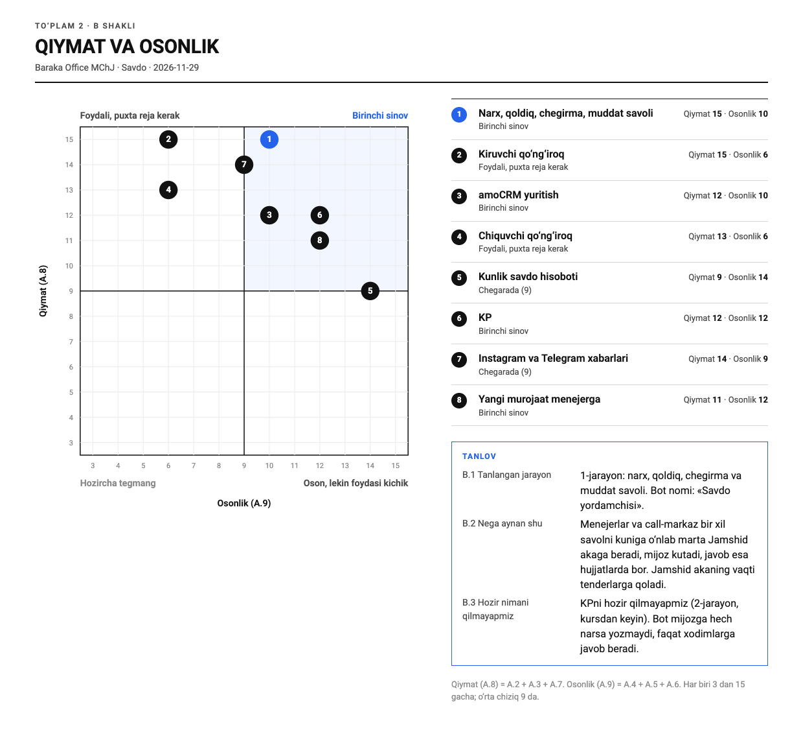

# 5-mashq. To‘plam 2: qiymat va osonlik matritsasi

2-dars · 1:40-1:47 · 7 daqiqa · Claude Code

## Maqsad

4-mashqdagi ballardan Claude Code matritsa chizadi va uni brauzerda ochiladigan sahifa qilib saqlaydi.
Har bir jarayon - raqamli nuqta.
Bir qarashda ko‘rasiz: qaysi jarayon foydali va AI’ga berish oson.

## Matritsani qanday o‘qiladi

- Gorizontal o‘q - Osonlik (A.9), 3 dan 15 gacha.
- Vertikal o‘q - Qiymat (A.8), 3 dan 15 gacha.
- Chegara 9 da, matritsa to‘rt qismga bo‘linadi:

| Qism | Qiymat | Osonlik | Ma’nosi |
|---|---|---|---|
| Birinchi sinov (yuqori o‘ng) | 9 dan katta | 9 dan katta | Shu yerdan boshlang |
| Foydali, puxta reja kerak (yuqori chap) | 9 dan katta | 9 dan kichik | Keyinroq, yaxshi tayyorgarlik bilan |
| Oson, lekin foydasi kichik (pastki o‘ng) | 9 dan kichik | 9 dan katta | Vaqt bo‘lsa, kichik yordamchi |
| Hozircha tegmang (pastki chap) | 9 dan kichik | 9 dan kichik | Bugungi muammo emas, keyinga qoldiring |

Ball aynan 9 bo‘lsa, nuqta «Chegarada».

## Qadamlar

1. 4-mashq tayyor: `kit2-scoring/form-a-scoring.md` da ballar bor.
2. Quyidagi promptni yuboring.
3. Claude sahifani yozadi va brauzerda ochadi.
   Ochilmasa: macOS’da `open kit2-scoring/matrix.html`, Windows’da `start kit2-scoring\matrix.html` deb yozing.
4. Nuqtalar to‘g‘ri joydami?
   Bitta nuqtani `form-a-scoring.md` bilan solishtiring.

## Prompt

```text
kit2-scoring/form-a-scoring.md dagi Qiymat (A.8) va Osonlik (A.9) bo‘yicha matritsa chiz va kit2-scoring/matrix.html sahifasi qilib saqla.
Gorizontal o‘q - Osonlik, vertikal o‘q - Qiymat, ikkalasi 3 dan 15 gacha, chegara 9 da.
To‘rt qism nomi: yuqori o‘ngda «Birinchi sinov», yuqori chapda «Foydali, puxta reja kerak», pastki o‘ngda «Oson, lekin foydasi kichik», pastki chapda «Hozircha tegmang».
Har bir jarayon raqamli nuqta bo‘lsin, yonida raqam va nom bilan ro‘yxat.
Sahifa internetsiz ishlasin: tashqi shrift va kutubxona ishlatma.
Keyin kit2-scoring/form-b-matrix.md dagi «Matritsadagi nuqtalar» jadvalini to‘ldir va sahifani brauzerda och.
```

## Agar sahifa chiroyli chiqmasa

Kursning tayyor andozasi bor: u /kit2 ishlatadigan sahifa.
Shu promptni yuboring (Claude `../skills` papkasini o‘qish uchun ruxsat so‘raydi, «Yes»):

```text
../skills/kit2/matrix-template.html faylini kit2-scoring/matrix.html ga nusxala.
Unda faqat <script id="data"> ichidagi JSON ni almashtir: kompaniya, bo‘lim, sana va jarayonlar (n, name, value = A.8, ease = A.9) form-a-scoring.md dan.
Boshqa hech narsani o‘zgartirma. Keyin sahifani brauzerda och.
```

## «Baraka Office» namunasi

Sahifa (zip ichida): `baraka-office/kompaniya/kit2-scoring/matrix.html` (kurs andozasi bilan chizilgan).
Ekran tasviri pastda.



Qanday o‘qiladi:

- 1 (narx, qoldiq, chegirma, muddat savoli), 3 (amoCRM yuritish), 6 (KP) va 8 (yangi murojaat menejerga) - yuqori o‘ngda: to‘rttasi ham birinchi sinovga nomzod.
  3 va 6 da [?] bor: ularning bir raqami hali tasdiqlanmagan.
- 2 (kiruvchi qo‘ng‘iroq) va 4 (chiquvchi qo‘ng‘iroq) - foydali, lekin jonli suhbat: puxta reja kerak.
- 5 (kunlik hisobot) va 7 (Instagram va Telegram xabarlari) - chegarada: ballardan biri aynan 9.
- Pastki chap qismda jarayon yo‘q.

Bir nechta nomzod bo‘lsa, qaysi biri?
Qiymati eng katta va [?] belgisi yo‘q jarayonni tanlang: Baraka’da bu 1-jarayon.
Yakuniy javobni 6-mashqda va uyda bo‘lim boshlig‘i bilan birga berasiz.

## Tayyor bo‘lsa

- [ ] `kit2-scoring/matrix.html` brauzerda ochiladi, internet o‘chiq bo‘lsa ham.
- [ ] Har bir jarayon raqamli nuqta, raqamlar `form-a-scoring.md` bilan bir xil.
- [ ] `form-b-matrix.md` dagi nuqtalar jadvali to‘ldirilgan.

## Ko‘p uchraydigan xatolar

| Nima bo‘ldi | Nima qilish kerak |
|---|---|
| Nuqtalar bir-birining ustida, raqam o‘qilmaydi | «Bir xil joydagi nuqtalarni biroz suring, raqamlar o‘qilsin» deng. |
| O‘qlar almashib qolgan | «Gorizontal o‘q Osonlik bo‘lsin» deng. |
| Sahifa internetdan shrift yuklayapti | «Tashqi shrift va kutubxonani olib tashla» deng, yoki andoza promptini ishlating. |
| Brauzer ochilmadi | Finder’da `kit2-scoring/matrix.html` ni ikki marta bosing. |

## Mentor tekshiruvi (2.7)

Sahifa ochiq, nuqtalar raqamli, ishtirokchi yuqori o‘ng qismdagi jarayonlarni ayta oladi.
