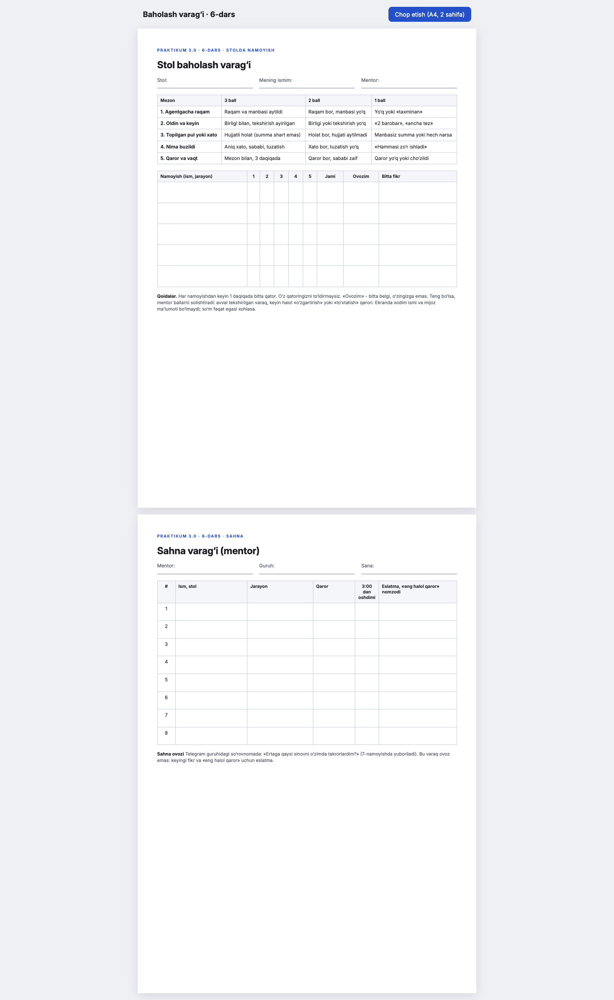

# Baholash varag‘i: stol va sahna

Chop etish uchun: `baholash-varagi.html` (A4, 1-sahifa stol, 2-sahifa sahna).

Har bir tinglovchiga bitta stol varag‘i; har bir mentorga bitta sahna varag‘i.

## Qanday ishlatish

1. Har bir namoyishdan keyin 1 daqiqa ichida bitta qatorni to‘ldiring.
2. Har mezonga 1, 2 yoki 3 ball qo‘ying (pastdagi jadval).
3. «Jami» - beshta ballning yig‘indisi (5-15).
4. O‘zingizning qatoringizni to‘ldirmaysiz.
5. Oxirida «Ovozim» ustunida bitta kishini belgilang (o‘zingizni emas).
6. Varaqni mentorga bering: ovozlar teng bo‘lsa, mentor ballarni solishtiradi.

Ball - ovoz emas: u mentorga teng ovozni hal qilishga va keyin har biringizga qisqa fikr berishga yordam beradi.

## Mezonlar

| # | Mezon | 3 ball | 2 ball | 1 ball |
|---|---|---|---|---|
| 1 | Agentgacha raqam | Raqam va manbasi aytildi | Raqam bor, manbasi yo‘q | Yo‘q yoki «taxminan» |
| 2 | Oldin va keyin | Birligi bilan, tekshirish ayirilgan | Raqam bor, birligi yoki tekshirish yo‘q | «2 barobar», «ancha tez» |
| 3 | Topilgan pul yoki oldi olingan xato | Hujjatli holat (summa shart emas) | Holat bor, hujjati aytilmadi | Manbasiz katta summa yoki hech narsa |
| 4 | Nima buzildi | Aniq xato, sababi va tuzatish | Xato bor, tuzatish yo‘q | «Hammasi zo‘r ishladi» |
| 5 | Qaror va vaqt | Mezon bilan asoslangan, 3 daqiqada | Qaror bor, sababi zaif | Qaror yo‘q yoki vaqt cho‘zildi |

## «Baraka Office» namunasi: stol varag‘i to‘ldirilgan

Tinglovchi: 1-stoldagi boshqa ishtirokchi.

| Namoyish | 1 | 2 | 3 | 4 | 5 | Jami | Ovozim | Bitta fikr |
|---|---|---|---|---|---|---|---|---|
| Rustamov S.A., savdo savollari | 3 | 3 | 3 | 3 | 3 | 15 | ✓ | «Bepul yetkazish xatosi menda ham bor» |
| [2-ishtirokchi], ombor qoldig‘i | 2 | 3 | 1 | 2 | 3 | 11 | | «Agentgacha raqam qayerdan?» |
| [3-ishtirokchi], kunlik hisobot | 3 | 2 | 2 | 3 | 2 | 12 | | «Tekshirish vaqti aytilmadi» |
| [4-ishtirokchi], qarzdorlik | 3 | 3 | 3 | 2 | 3 | 14 | | «To‘xtatish qarori halol» |

Hoshiyadagi izohlar:

- Rustamov 3-mezondan 3 oldi, garchi summani aytmagan bo‘lsa ham: «hujjatli bitta holat» yetarli.
- 2-ishtirokchi 1-mezondan 2 oldi: raqam bor, lekin qayerdan olingani aytilmadi.
- 4-ishtirokchi qarorini «to‘xtatish» qilgan, lekin 5-mezondan 3 oldi: halol to‘xtatish yaxshi qaror.

## Yomon to‘ldirish

| Namoyish | Jami | Ovozim |
|---|---|---|
| Hammasi | 15 | Do‘stim |

Nimasi yomon: hamma bir xil ball oldi - mentor teng ovozni hal qila olmaydi va hech kim fikr olmaydi.

## Sahna varag‘i (mentorlar va bosh mentor)

8 qator: ism, jarayon, qaror, vaqt (3:00 dan oshdimi), bitta savol, «eng halol qaror» nomzodi.
Sahna ovozi Telegram so‘rovnomasida; varaq faqat eslatma va keyingi fikr uchun.
