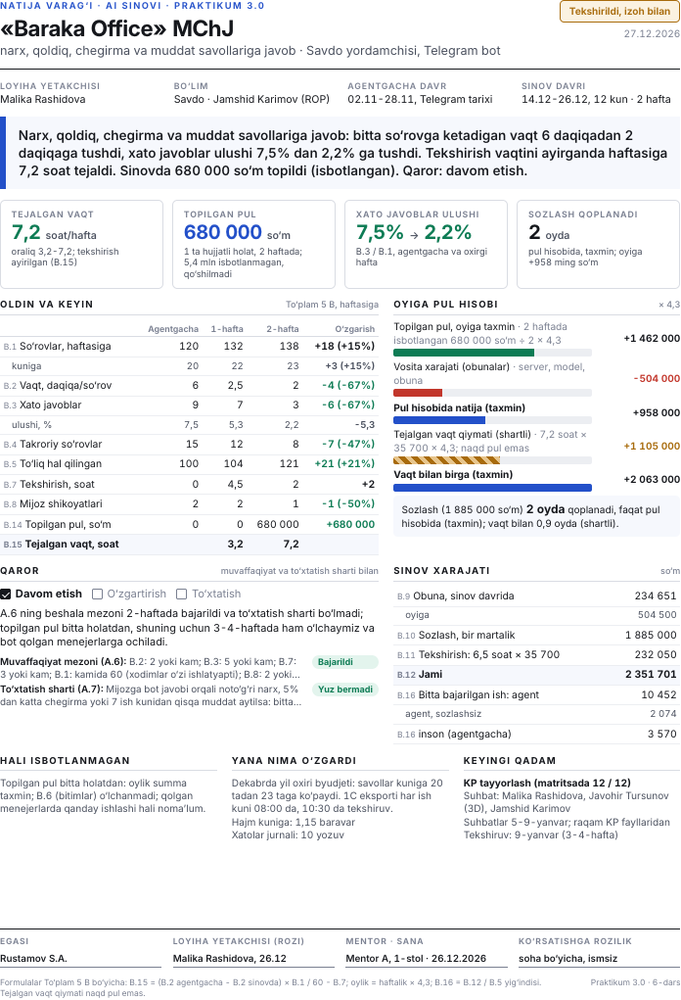

# 1-mashq. Yakuniy raqamlar va natija varag‘i

6-dars · 0:14-0:32 · 18 daqiqa · Claude Code va brauzer

## Maqsad

To‘plam 5 B shaklini yopasiz: o‘zgarish ustuni, jami xarajat, tejalgan vaqt, bitta bajarilgan ish narxi va topilgan pul.
Keyin hammasini bitta A4 varaqqa chiqarasiz: natija varag‘i.
Mentoringiz raqamlarni darsdan oldin tekshirgan; bugun faqat oxirgi kun raqami, xarajatlar va varaq qoladi.

## Boshlashdan oldin nima kerak

| Nima | Qayerda | Bo‘lmasa |
|---|---|---|
| `kit5-pilot/numbers.md`: agentgacha, 1-hafta, 2-hafta (mentor tekshirgan kunlar) | Kompaniya papkangiz | Mentoringizga hozir ayting |
| Darsdan oldingi kun raqamlari: yakshanba guruhida shanba, shanba guruhida juma (bot jurnalidan yoki qo‘lda) | Botning `/hafta` buyrug‘i yoki daftar | Ish kunlariga nechta kun bo‘lsa, shuni yozing; shanba guruhida 2-hafta odatda 5 kun (shanba - dars kuni) |
| B.7: shu hafta tekshirishga ketgan soat | Tekshiruvchidan so‘rang (bitta raqam, butun vazifa uchun) | Taxmin qilmang: so‘rang |
| Soatbay haq: oklad / oyiga ish soati | Buxgalter | Oklad va ish jadvalidan hisoblang (pastdagi namuna) |
| Oylik xarajatlar | Server hisobi, OpenRouter paneli, Claude kvitansiyasi | Panel skrinshotini oching |
| Topilgan pulning har bir holati va hujjati | CRM bitim kartasi, buxgalter | Holat yo‘q bo‘lsa, 0 va sababi |
| `results-sheet/index.html` | Darsga berilgan 6-dars papkasi | Mentoringizdan nusxa oling |

## Qadamlar

1. Darsdan oldingi kun raqamlarini 2-hafta ustuniga qo‘shing (yoki bot yuborgan oxirgi haftalik faylni oching).
2. Claude Code’da kompaniya papkangizda yozing: `/kit5 yakun`.
   Skill sizdan so‘raydi; **To‘xtang** degan joyda javob bering.
   U o‘zgarish ustunini, B.11, B.12, B.15, B.16 ni va isbotlangan pulni hisoblab, `numbers.md` ga formulasi bilan yozadi.
3. Natijani tekshiring: B.15 ni bitta hafta uchun qo‘lda qayta hisoblang (pastdagi formula).
   Farq 10 foizdan oshsa, mentorni chaqiring.
4. `results-sheet/index.html` ni oching: «Kit 5 faylini ochish» → `numbers.md` va `plan.md`.
5. Har ustunga ish kunlarini yozing (sariq kataklar).
6. Soatbay haqni, oylik xarajatlarni (server, model, Claude) va sozlash xarajatini (B.10) yozing.
7. Har bir topilgan pul holatida «Qanday hisobladik va manbasi» ni to‘ldiring; hujjati borini «Isbotlangan» deb belgilang.
8. Pastdagi «Tekshiruv» qutisini o‘qing va qizil yozuvlarni tuzating.
   Tuzatib bo‘lmasa (masalan, agentgacha raqami yo‘q), «Hali isbotlanmagan» maydoniga halol yozing.
9. Hali chop etmang: qarorni 2-mashqda qo‘yasiz.

Claude Code ochilmasa: To‘plam 5 dagi «AI chat uchun so‘rov» ni nusxalab, `numbers.md` va `plan.md` matni bilan Claude, ChatGPT yoki Gemini chatiga joylang.

## Formulalar (To‘plam 5)

- Tejalgan vaqt, soat/hafta: B.15 = (B.2 agentgacha - B.2 sinovda) × B.1 sinovda / 60 - B.7.
- Jami xarajat: B.12 = B.9 + B.10 + B.11; B.11 = B.7 yig‘indisi × soatbay haq.
- Bitta bajarilgan ish narxi: agent = B.12 / sinov haftalaridagi B.5 yig‘indisi; inson = B.2 agentgacha / 60 × soatbay haq.
- Oylik: haftalik × 4,3.

## «Baraka Office» namunasi

To‘liq fayl: `namuna/kompaniya/kit5-pilot/numbers.md` (har bir hisob formulasi bilan).
Natija varag‘i: `../results-sheet/index.html?namuna=baraka`.

| Ko‘rsatkich | Agentgacha | 1-hafta | 2-hafta | O‘zgarish | Hoshiyadagi izoh |
|---|---|---|---|---|---|
| B.1 So‘rovlar | 120 | 132 | 138 | +18 (+15%) | Kuniga 20 → 23: dekabr mavsumi, «Yana nima o‘zgardi» ga yozildi |
| B.2 Daqiqa | 6 | 2,5 | 2,0 | -4,0 (-67%) | Madina 10 ta holatni soat bilan o‘lchagan, tekshirishsiz |
| B.3 Xatolar | 9 | 7 | 3 | -6 (-67%) | Xatolar jurnalidagi 10 qatorga teng (7 + 3) |
| B.7 Tekshirish, soat | 0 | 4,5 | 2,0 | +2,0 | 1-haftada Malika har bir qoralamani tasdiqlagan; 2-haftada qisman to‘g‘ridan-to‘g‘ri: chegirma va muddat 100% tasdiqlandi, narx va qoldiq darhol ketdi (har 5 tadan biri keyin ko‘rildi) |
| B.14 Topilgan pul | 0 | 0 | 680 000 | | Bitta hujjatli holat: 12% so‘ralgan, 10% berilgan (34 mln, ROP ruxsati va 100% oldindan to‘lov) |

Hoshiyadagi izohlar:

- **Soatbay haq 35 700 so‘m.**
  Savollarga Madina (5 000 000 / 200 = 25 000), Malika (22 500) va Jamshid aka (60 000) javob beradi; kuniga taxminan 12, 5 va 8 ta (egasining bahosi).
  O‘rtacha: (12 × 25 000 + 5 × 22 500 + 8 × 60 000) / 25 = 35 700.
  200 soat - Baraka ish jadvali: haftasiga 46 soat × 4,3.
- **B.15 = (6 - 2,0) × 138 / 60 - 2,0 = 7,2 soat.**
  1-haftada 3,2: tekshirish 4,5 soat edi.
  Asosiysi oxirgi to‘liq hafta.
- **Oylik xarajat 504 500 so‘m:** server 200 000, OpenRouter 37 000 (2 haftada 1,45 $), Claude Pro 267 500 (20 $ + 12% QQS).
  Claude to‘liq qo‘shilgan, garchi egasi uni boshqa ishlarga ham ishlatsa ham: ehtiyotkor hisob.
- **B.10 = 1 885 000 so‘m:** egasining 14 soati (25 000 000 / 200 = 125 000 × 14) va IT xodim Sardorbekning 3 soati (45 000 × 3).
- **B.16:** agent 10 452 so‘m (sozlash bilan), sozlashsiz 2 074 so‘m; inson 3 570 so‘m.
  Sozlash puli birinchi oylarda qaytadi, keyin agent arzonroq.
- **Topilgan pul faqat bitta holat.**
  2 haftada isbotlangani - 680 000 so‘m; oyiga 1 462 000 so‘m - taxmin, isbot emas.
  Ikkita boshqa holat (muddat va’da qilinmagani, 5,4 mln so‘mlik sotuv) yozilgan, lekin yig‘indiga qo‘shilmagan: biri pul emas, ikkinchisi tushum va bot tufayli ekani isbotlanmagan.

Varaqni qanday o‘qish: `../results-sheet/natija-varagi.qollanma.md`, 6-bo‘lim.

## Yomon namuna

> B.2: 2 daqiqa. Vaqt 3 barobar tejaldi. Tekshirish: yo‘q. Topilgan pul: oyiga 10 mln.

Nimasi yomon:

1. «3 barobar» nimaga nisbatan? Agentgacha ustuni bo‘sh.
2. «Tekshirish: yo‘q» - lekin kimdir har bir javobni o‘qigan; bu B.7, va u ayiriladi.
3. «Oyiga 10 mln» - hujjat yo‘q, tejalgan soat pulga aylantirilgan, va oylik raqam isbot deb aytilgan.

To‘g‘rilangani (Baraka bilan bir xil shaklda):

> B.2: 6 daqiqadan 2,0 daqiqaga (10 ta holat o‘lchangan).
> B.7: 2,0 soat.
> Tejalgan vaqt: (6 - 2,0) × 138 / 60 - 2,0 = 7,2 soat/hafta.
> Topilgan pul: 2 haftada 680 000 so‘m, bitta holat, amoCRM kartasi va ROP ruxsati bilan; oyiga taxminan 1,46 mln (taxmin).

## Tayyor bo‘lsa

- [ ] `numbers.md` da har qatorda: agentgacha, 1-hafta, 2-hafta, o‘zgarish.
- [ ] B.9-B.12 to‘ldirilgan, B.15 va B.16 formulasi bilan.
- [ ] Topilgan pulning har bir holati manbasi bilan; manbasizi alohida yoki o‘chirilgan.
- [ ] Natija varag‘ida qizil yozuv yo‘q (yoki sababi «Hali isbotlanmagan» da yozilgan).
- [ ] Bitta haftaning B.15 ini qo‘lda qayta hisobladingiz.

## Ko‘p uchraydigan xatolar

| Nima bo‘ldi | Nima qilish kerak |
|---|---|
| Kunlik va haftalik daqiqa aralashgan | Hamma narsa haftasiga; B.2 bitta ishga daqiqa |
| B.7 ham yozilgan, B.2 ga ham tekshirish qo‘shilgan | B.2 dan tekshirishni chiqaring |
| Fayl ochilmadi | Matnni nusxalab «Fayl ochilmasa» qutisiga qo‘ying |
| Bot jurnalida «qo‘lda» qatorlar | Ularni o‘zingiz yozasiz: bot ularni o‘lchay olmaydi |
| 2-hafta 5 kunlik, agentgacha 6 kunlik | Ish kunlarini to‘g‘ri yozing: varaq kuniga hisoblaydi |

## Mentor tekshiruvi (6.1)

2-hafta ustuni, B.7, B.9-B.11 va B.14 (topilmagan bo‘lsa «0» va sababi) ekranda.
Jadvalga dalil: «numbers.md va natija varag‘i, [xulosa], [sana]».
