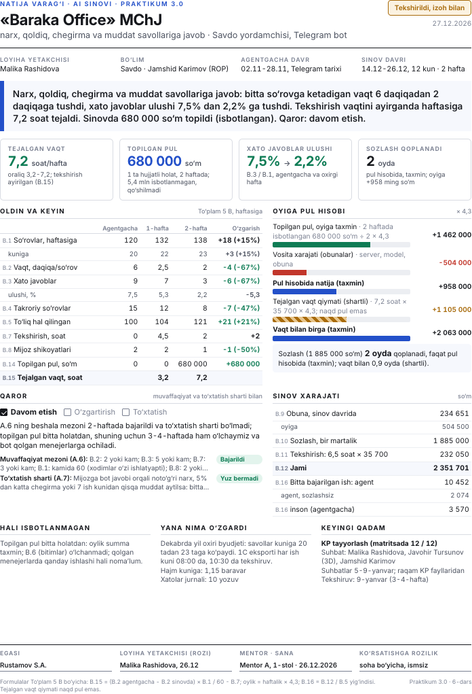
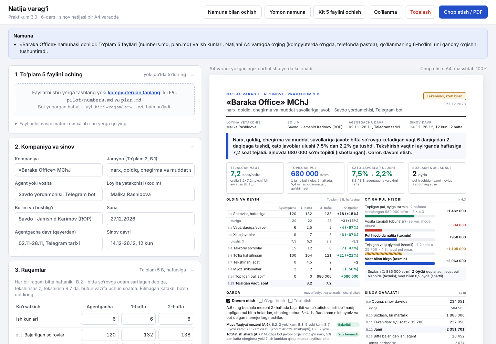
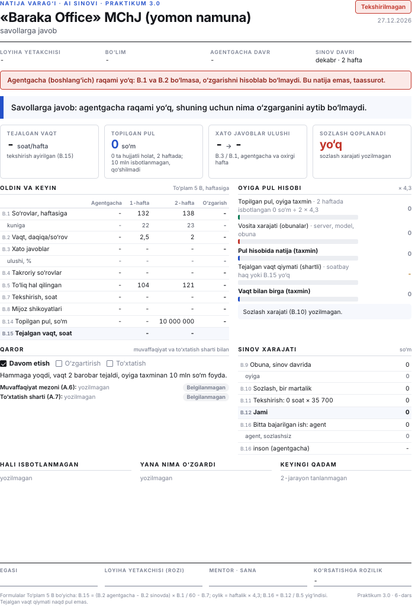
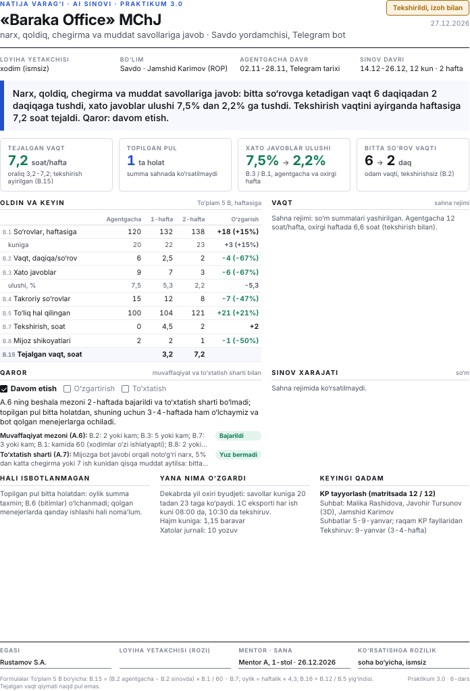

# Natija varag‘i: qanday ishlatish

Praktikum 3.0 · 6-dars · Fayl: `results-sheet/index.html`

## 1. Bu nima va kim uchun

Natija varag‘i - sinovingiz natijasi bitta A4 varaqda.
Uni hamkoringizga, bo‘lim boshlig‘iga yoki o‘zingizga bir yildan keyin ko‘rsatasiz.
Varaqda beshta narsa bor: agentgacha va keyin raqamlar, tejalgan soat va topilgan pul, xato javoblar ulushi, vositaning narxi va qoplanish muddati, qaror va keyingi jarayon.
Sahifa internetsiz ishlaydi: `index.html` ni brauzerda (Chrome, Edge, Safari) oching.
Kiritgan narsangiz shu kompyuterning brauzerida saqlanadi; boshqa hech qayerga yuborilmaydi.

## 2. Boshlashdan oldin nima kerak

| Nima | Qayerdan | Kim beradi |
|---|---|---|
| `kit5-pilot/numbers.md`: agentgacha, 1-hafta, 2-hafta ustunlari, B.7 va topilgan pul tafsiloti | Kompaniya papkangiz; `/kit5 hafta 2` va `/kit5 yakun` to‘ldiradi | Siz, Claude Code bilan |
| `kit5-pilot/plan.md`: A.6 muvaffaqiyat mezoni, A.7 to‘xtatish sharti | Kompaniya papkangiz (4-darsda yozilgan) | Siz va bo‘lim boshlig‘i |
| Ish kunlari: har hafta nechta kun ishladingiz | Kalendar, bayramlar | Siz |
| Soatbay haq: ishni bajaradiganlarning oklad / oylik ish soati | Ish haqi varag‘i | Buxgalter |
| Oylik xarajat: server, model (OpenRouter), Claude obunasi | Provayder hisobi, OpenRouter paneli, Claude kvitansiyasi | Siz |
| Sozlash xarajati (B.10): kim necha soat sarfladi, kimga necha so‘m to‘landi | O‘z hisobingiz, IT xodim | Siz |
| Topilgan pulning har bir holati va hujjati | CRM bitim kartasi, hisob-faktura, buxgalter tasdig‘i | Siz va buxgalter |

Mentor bu raqamlarni darsdan oldingi uch kunda tekshiradi.
Darsda faqat yakuniy ustun va qaror qoladi.

## 3. Bosqichma-bosqich

1. Sahifani oching va avval «Namuna bilan ochish» tugmasini bosing.
   Baraka Office varag‘ini 2 daqiqa o‘qing: sizniki ham shunday bo‘ladi.
2. «Tozalash», keyin «Kit 5 faylini ochish»: `numbers.md` va `plan.md` ni birga tanlang.
   Fayllarni ramkaga sudrab tashlasangiz ham bo‘ladi.
   Fayl ochilmasa, uning matnini nusxalab «Fayl ochilmasa» qutisiga qo‘ying.
3. Ochilgandan keyin ko‘k xabarni o‘qing: nechta hafta va nechta topilgan pul yozuvi o‘qilgani yoziladi.
4. 3-bo‘limda har ustun uchun «Ish kunlari» ni yozing (sariq kataklar).
5. 4-bo‘limda soatbay haqni, oylik xarajatlarni va sozlash xarajatini yozing.
   Kit 5 faylidan kelgan B.9 bitta qator bo‘lib keladi; xohlasangiz uni server, model va obunaga ajrating.
6. Topilgan pulning har bir holatida «Qanday hisobladik va manbasi» ni to‘ldiring.
   Manbasi bor holatga «Isbotlangan» belgisini qo‘ying; manbasiz summa yig‘indiga qo‘shilmaydi.
7. 5-bo‘limda mezon bajarildimi, to‘xtatish sharti yuz berdimi, qaror va sababini belgilang.
8. 6-bo‘limda keyingi jarayonni, suhbatdoshlarni va imzo qatorlarini yozing.
9. Pastdagi «Tekshiruv» qutisini o‘qing: qizil - natija yo‘q; sariq - tuzating yoki izoh yozing; ko‘k - ma’lumot uchun.
10. Mentor bilan varaqni ko‘rib chiqing, keyin «Chop etish / PDF».

## 4. Har bir maydon: nima va qayerdan

| Maydon | Oddiy so‘z bilan | Qayerdan |
|---|---|---|
| B.1 Bajarilgan so‘rovlar | Haftasiga nechta ish keldi va bajarildi (hammasi, faqat agent qilgani emas) | Bot jurnali, Telegram eksporti |
| B.2 O‘rtacha vaqt, daqiqa | Bitta ishga odam sarflagan daqiqa, tekshirishsiz | 10 ta holatni soat bilan o‘lchash |
| B.3 Xato javoblar | Noto‘g‘ri javoblar soni; xatolar jurnalidagi qatorlar soniga teng | Xatolar jurnali (B.13) |
| B.4 Takroriy so‘rovlar | Bir mijoz bir narsani qayta so‘ragani | Telegram eksporti |
| B.5 To‘liq hal qilingan | Qo‘shimcha savolsiz yopilgan ishlar | Bot jurnali |
| B.6 Bitimlar | Shu jarayondan chiqqan bitim yoki buyurtma; bog‘lab bo‘lmasa bo‘sh qoldiring | CRM |
| B.7 Tekshirish vaqti, soat | Agent ishini tekshirishga butun vazifa bo‘yicha haftasiga necha soat ketdi | Tekshiruvchining o‘zi aytadi |
| B.8 Mijoz shikoyatlari | Shu jarayon bo‘yicha shikoyatlar | CRM, chat |
| B.14 Topilgan pul | Oldi olingan xato, yo‘qolmagan so‘rov, tezroq tushgan pul; har biri hujjat bilan | Bitim kartasi, buxgalter |
| Ish kunlari | Shu hafta nechta kun ishlandi | Kalendar |
| Soatbay haq | Oklad / oyiga ish soati (o‘z jadvalingiz bo‘yicha: haftasiga 40 soat bo‘lsa 173,3; Baraka’da 46 soat, taxminan 200); tekshiruvchi boshqa odam bo‘lsa, uning haqi alohida maydonda | Buxgalter: ijtimoiy soliqni ham qo‘shish kerakmi, undan so‘rang |
| Oylik xarajat | Vosita ishlab turishi uchun har oy to‘lanadigan pul | Hisob-fakturalar |
| Sozlash (B.10) | Bir marta sarflangan: sizning va IT xodimning soatlari, tashqi to‘lov | O‘z hisobingiz |

Varaq o‘zi hisoblaydigan qatorlar, To‘plam 5 dagi formulalar bilan:

- Tejalgan vaqt (B.15) = (B.2 agentgacha - B.2 sinovda) × B.1 sinovda / 60 - B.7.
  Bu ehtiyotkor hisob: agentgacha ham kimdir tekshirgan bo‘lsa (agentgacha B.7), formula uni hisobga olmaydi.
- Sinov xarajati: B.9 = oylik xarajat × hafta / 4,3; B.11 = B.7 yig‘indisi × soatbay haq; B.12 = B.9 + B.10 + B.11.
- Bitta bajarilgan ish narxi (B.16): agent = B.12 / B.5 yig‘indisi; inson = B.2 agentgacha / 60 × soatbay haq.
- Xato javoblar ulushi = B.3 / B.1 × 100.
- Oylik: haftalik × 4,3.
- Pul hisobida natija = oylik topilgan pul - oylik xarajat.
  Oylik topilgan pul - taxmin: sinovda isbotlangan summa ÷ hafta × 4,3.
- Tejalgan vaqt qiymati = B.15 × soatbay haq × 4,3; bu shartli, naqd pul emas.
- Qoplanish = sozlash xarajati / oylik pul natijasi.

Varaqda muvaffaqiyat mezoni va to‘xtatish sharti ikki qatorga qisqartiriladi; to‘liq matni `plan.md` da.

## 5. Ko‘p uchraydigan xatolar

| Xato | Nega yomon | To‘g‘risi |
|---|---|---|
| Agentgacha ustuni bo‘sh | O‘zgarishni hisoblab bo‘lmaydi: bu taassurot | 2-darsdan keyingi `baseline.md` ni oching; yo‘q bo‘lsa, «natija yo‘q, sababi» deb halol yozing |
| Kunlik va haftalik daqiqalar aralashgan | Natija 5-6 baravar xato chiqadi | Hamma qator haftasiga; B.2 bitta ishga daqiqa |
| B.7 bo‘sh | Tejalgan vaqt bo‘rttiriladi | Tekshiruvchidan haftalik soatni so‘rang |
| B.2 ga tekshirish vaqti ham qo‘shilgan va B.7 ham yozilgan | Tekshirish ikki marta ayiriladi | B.2 tekshirishsiz, tekshirish faqat B.7 da |
| Topilgan pul manbasiz | Mentor o‘chiradi, hamkor ishonmaydi | Har holat: sana, hujjat, kim tasdiqladi |
| Tushum topilgan pul deb yozilgan | Tushum foyda emas | Faqat oldi olingan yo‘qotish yoki aniq qo‘shimcha foyda |
| Tejalgan soat «oyiga X so‘m foyda» deb yozilgan | Maosh kamaymagan bo‘lsa, bu pul emas | Varaq ikki qatorni alohida ko‘rsatadi: pul va shartli vaqt |
| Claude obunasi yozilmagan | Vosita arzon ko‘rinadi | Obunani to‘liq yoki ulushini yozing |
| Ish kunlari yozilmagan | Bayram haftasi «tushish» bo‘lib ko‘rinadi | Har ustunga kunlar soni |

## 6. Natijani qanday o‘qish: «Baraka Office» namunasi

Yuqoridan pastga o‘qing:

1. **Ko‘k ramkadagi gap** - butun natija bitta gapda: vaqt 6 daqiqadan 2 daqiqaga, xato ulushi 7,5% dan 2,2% ga, haftasiga 7,2 soat tejaldi, 680 000 so‘m topildi, qaror - davom etish.
   Hamkoringiz faqat shu gapni o‘qishi mumkin; u to‘g‘ri bo‘lsin.
2. **To‘rtta kartochka.**
   Tejalgan vaqt 7,2 soat/hafta (1-haftada 3,2, chunki tekshirish ko‘p edi).
   Topilgan pul 680 000 so‘m, 2 haftada bitta hujjatli holat; 5,4 mln so‘mlik sotuv hisobga olinmagan, chunki bu tushum va bot tufayli ekani isbotlanmagan.
   Sozlash taxminan 2 oyda qoplanadi, pul hisobida; bu taxmin, chunki oylik pul bitta holatdan hisoblangan.
3. **Oldin va keyin jadvali.**
   Yashil - yaxshilangan, qizil - yomonlashgan.
   «kuniga» qatori so‘rovlar 20 tadan 23 taga ko‘payganini ko‘rsatadi: dekabr mavsumi, «Yana nima o‘zgardi» da yozilgan.
4. **Oyiga pul hisobi.**
   Yashil chiziq - topilgan pulning oylik taxmini (2 haftadagi 680 000 so‘mdan), qizil - xarajat, ko‘k - pul natijasi, chiziqli sariq - tejalgan vaqt qiymati.
   Oylik summalar taxmin: isbotlangani faqat 2 haftadagi 680 000 so‘m.
   Sariqni pulga qo‘shib gapirmang: maoshlar o‘zgarmaydi.
   U faqat tejalgan soat yangi ishga ketganda qiymat bo‘ladi.
5. **Sinov xarajati.**
   B.16: sozlash bilan bitta ish agentda 10 452 so‘m, odamda 3 570 so‘m.
   Sozlashsiz agentda 2 074 so‘m.
   Ma’nosi: sozlash puli birinchi oylarda qaytadi, keyin agent arzonroq.
6. **Qaror.**
   Mezon bajarildi, to‘xtatish sharti yuz bermadi, qaror va sababi bitta gapda.
7. **Mentor belgisi** «Tekshirildi, izoh bilan»: raqamlar to‘g‘ri, izoh - topilgan pul bitta holatdan, oylik summa taxmin.

Telefonda varaq kichik ko‘rinadi; to‘ldirish mumkin, lekin chop etish va PDF uchun kompyuter qulay.

## 7. Tayyor bo‘lsa

- [ ] «Tekshiruv» qutisida qizil yozuv yo‘q.
- [ ] Agentgacha, 1-hafta va 2-hafta ustunlari to‘la, har ustunda ish kunlari bor.
- [ ] B.7 har haftada yozilgan.
- [ ] Topilgan pulning har bir holati hujjati bilan; isbotlanmagani alohida.
- [ ] Qaror belgilangan, sababi bitta gapda, A.6 va A.7 bilan solishtirilgan.
- [ ] Keyingi jarayon va suhbatdoshlar yozilgan.
- [ ] Mentor tekshirdi va belgisini qo‘ydi, sinov egasi raqamlarga rozi.
- [ ] PDF saqlangan: `kit5-pilot/natija-varagi.pdf`.

## 8. Yomon namuna: raqam bor, boshlang‘ich holat yo‘q

«Yomon namuna» tugmasi shu faylni ochadi: `namuna/yomon-numbers.md`.

Unda nima yozilgan:

> Hammaga yoqdi, vaqt 2 barobar tejaldi, oyiga taxminan 10 mln so‘m foyda.

Nimasi yomon:

1. Agentgacha ustuni bo‘sh: «2 barobar» nimaga nisbatan ekanini hech kim bilmaydi.
   Varaq qizil yozuv chiqaradi va mentor belgisini «Tekshirilmagan» qiladi.
2. B.7 bo‘sh: tekshirish vaqti hisobga olinmagan.
3. B.3 da «ko‘p emas», «kam»: bu raqam emas.
4. «10 mln foyda» ning hujjati yo‘q, va u tejalgan vaqtni pul deb hisoblagan.
   Varaq uni yig‘indiga qo‘shmaydi.
5. «Hammaga yoqdi» - sabab emas: mezon va to‘xtatish sharti yozilmagan.

To‘g‘rilangan varianti - Baraka namunasining o‘zi: xuddi shu 2 hafta, lekin agentgacha raqamlari (120 so‘rov, 6 daqiqa, 9 xato), B.7 (4,5 va 2,0 soat), bitta hujjatli holat (680 000 so‘m) va A.6 bilan solishtirilgan qaror.
Halol kichik raqam katta taxmindan kuchli.
Agentgacha raqamingiz umuman bo‘lmasa, varaqqa «natija o‘lchanmadi: boshlang‘ich raqam yo‘q edi» deb yozing va 3-4-haftada eski holatni bir hafta qayta o‘lchang (botni bir hafta o‘chirib emas, tarixdan: Telegram yoki CRM eksporti).

## 9. Chop etish va PDF

1. «Chop etish / PDF» tugmasini bosing.
2. Printer: «Save as PDF» (PDF sifatida saqlash) yoki printeringiz.
3. Qog‘oz: A4, joylashuv: portret (tik), masshtab: 100% (yoki «Default»).
4. «Headers and footers» (sarlavha va pastki yozuvlar) belgisini olib tashlang.
5. «Background graphics» (fon rasmlari) belgisini qo‘ying, aks holda ranglar chiqmaydi.
6. Faylni `kit5-pilot/natija-varagi.pdf` deb saqlang va mentoringizga stol chatida yuboring.

Varaq har doim bitta sahifa bo‘ladi; matn juda uzun bo‘lsa, pastki qatorlar kesiladi, shuning uchun izohlarni qisqa yozing.

## 10. Sahna rejimi

Zalda raqobatchingiz o‘tirgan bo‘lishi mumkin.
«7. Ko‘rinish» bo‘limida «Sahna rejimi» ni yoqsangiz, so‘m summalari va xodim ismi yashiriladi: soat, daqiqa, xatolar soni va qaror qoladi.
Hamkor uchun varaqni sahna rejimisiz chop eting.

«Kurs to‘lovi qancha vaqtda qoplanishini ham ko‘rsatish» - faqat o‘zingiz uchun: kurs narxini 12 oyga bo‘lib, hozirgi oylik natija bilan solishtiradi.
Odatda u o‘chiq turadi.
