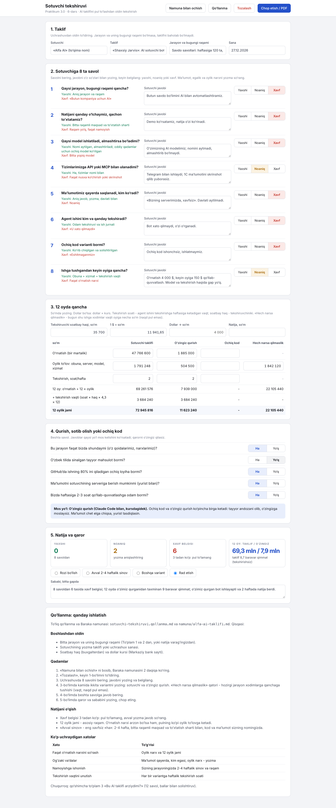

# Sotuvchi tekshiruvi: qanday ishlatish

Praktikum 3.0 · 6-dars · Fayllar: `index.html` (ekranda), `sotuvchi-tekshiruvi.md` (chop etish uchun)

## 1. Bu nima uchun

Kurs tugagach sizga «AI agent qurib beramiz», «shaxsiy Jarvis» yoki «AI sotuvchi» taklif qilishadi.
Bu varaq pul to‘lashdan oldin taklifni bir xil 8 ta savol bilan tekshirishga va uni o‘zingiz qurish bilan 12 oy bo‘yicha solishtirishga yordam beradi.
Savollar o‘quv dasturining «Vendor checklist» qismidan; chuqurroq versiyasi - qo‘shimcha to‘plam 3 «Bu AI taklifi arziydimi?» (12 savol, ballar bilan).

## 2. Boshlashdan oldin nima kerak

| Nima | Qayerdan |
|---|---|
| Bitta jarayon va uning bugungi raqami (qancha ish, qancha vaqt, nechta xato) | To‘plam 1 va 2, natija varag‘ingiz |
| Sotuvchining taklifi (yozma bo‘lsa yaxshi) | Sotuvchi |
| Tekshiruvchining soatbay haqi: oklad / oyiga ish soati (Baraka’da 200) | Buxgalter |
| Dollar kursi | Markaziy bank sayti (cbu.uz) |
| O‘zingiz qurishning oylik xarajati | Natija varag‘ingiz: server, model, obuna |

## 3. Bosqichma-bosqich

1. `index.html` ni oching, «Namuna bilan ochish» ni bosing va Baraka misolini 2 daqiqa ko‘ring.
2. «Tozalash», keyin 1-bo‘lim: sotuvchi, taklif, jarayon va uning raqami.
3. Uchrashuvda 8 savolni bering.
   Javobni sotuvchining o‘z so‘zlari bilan qisqa yozing, keyin belgilang: yaxshi, noaniq yoki xavf.
   Yaxshi javob va xavf belgisi har savolning ostida yozilgan.
4. 3-bo‘lim: har variant uchun o‘rnatish, oylik to‘lov va haftalik tekshirish soati; «Soatbay haq» - tekshiruvchiniki.
   Dollarda bo‘lsa, «Dollar → so‘m» maydonidan foydalaning.
   «Hech narsa qilmaslik» ustuniga bugun shu ishga ketadigan xodim vaqtini oyiga so‘mda yozing: soat × soatbay haq × 4,3.
5. 4-bo‘lim: beshta «ha / yo‘q» savoli; sahifa mos yo‘lni ko‘rsatadi.
6. 5-bo‘lim: qaror va sababi bitta gapda.
7. «Chop etish / PDF» va faylni kompaniya papkangizga saqlang: `vendor-check/` yoki `kit2-scoring/`.

## 4. Har bir savol: nima so‘raysiz va nega

| # | Savol | Nega muhim |
|---|---|---|
| 1 | Qaysi jarayon, bugungi raqami? | «Butun kompaniya uchun AI» natijasi o‘lchanmaydi |
| 2 | Qanday o‘lchaymiz, qachon to‘xtatamiz? | Siz 6 hafta shuni o‘rgandingiz: maqsad va to‘xtatish sharti oldindan |
| 3 | Qaysi model, almashtirsa bo‘ladimi? | Bitta yopiq modelga qamalib qolish: narx oshsa, chiqish yo‘q |
| 4 | API yoki MCP bilan ulanadimi? | Skrinshot va nusxa - har kungi qo‘l ishi va eski ma’lumot |
| 5 | Ma’lumot qayerda, kim ko‘radi? | Shaxsiy ma’lumot chet elga faqat qonundagi shartlar bilan; yurist tasdiqlasin |
| 6 | Kim tekshiradi? | Har bir agent xato qiladi; muhimi - kim va qachon topadi |
| 7 | Ochiq kod varianti? | Ko‘p ishni bepul loyiha allaqachon qiladi |
| 8 | Oyiga qancha? | 12 oyda pulning ko‘pi oylik to‘lovga ketadi |

## 5. Ko‘p uchraydigan xatolar

| Xato | Nega yomon | To‘g‘risi |
|---|---|---|
| Faqat o‘rnatish narxini solishtirish | 12 oyda oylik to‘lov ko‘proq | 12 oylik jami |
| Namoyishga ishonish | Namoyish sizning jarayoningizda emas | 2-4 haftalik sinov sizning raqamingiz bilan |
| Og‘zaki va’da | Keyin isbotlab bo‘lmaydi | Ma’lumot, egalik, oylik narx - yozma |
| Tekshirish vaqtini unutish | Arzon bot ko‘p tekshiruv talab qilsa, qimmat | Har variantga haftalik soat |
| Kurs narxini «o‘zingiz qurish» ga qo‘shish | Kurs bitta jarayon uchun emas | O‘zingiz qurish ustunida faqat sozlash va oylik xarajat |

## 6. Natijani qanday o‘qish: Baraka namunasi

- **Xavf belgisi 6 ta** (chegara 3): pul to‘lanmaydi.
- **12 oy:** «Alfa AI» 69,3 mln, o‘zi qurgani 7,9 mln so‘m (tekshirishsiz); tekshirish bilan 72,9 va 11,6 mln.
- **Mos yo‘l:** o‘zingiz qurish yoki ochiq kod: jarayon Barakaga xos, tayyor o‘zbekcha mahsulot topilmadi, andoza bor, qo‘llab-quvvatlashga odam bor.
- **Qaror:** rad etish, sababi bitta gapda.

To‘liq namuna, hoshiyadagi izohlar bilan: `namuna/alfa-ai-taklifi.md`.

## 7. Yomon namuna

> Chiroyli namoyish, o‘rnatish 4 000 $, arzon ekan, imzolaymiz.

Nimasi yomon: savollar berilmagan, faqat o‘rnatish narxi ko‘rilgan, ma’lumot va egalik so‘ralmagan.
To‘g‘rilangani: 8 savol, 12 oylik jami va «avval 2-4 haftalik sinov» yoki «rad etish» qarori (namuna faylida).

## 8. Bozor narxlari (mo‘ljal uchun)

- GPTBot.uz: AI bot 1,99 mln so‘mdan (bitta kanal), qo‘llab-quvvatlash oyiga 490 000 so‘mdan; model xarajati alohida (sahifa sanasi 18.09.2026, tekshirildi 03.11.2026).
- Fera Tech bahosi: CRM bilan ishlaydigan AI agent 5 mln so‘mdan, qo‘llab-quvvatlash oyiga taxminan 50 $ dan (16.02.2026, tekshirildi 03.11.2026).
- «Shaxsiy Jarvis»: 2 000-5 000 $ (kursda kuzatilgan, tekshirilmagan).
- O‘zingiz qurish: server oyiga taxminan 200 000 so‘m, model oyiga bir necha dollar, Claude Pro 20 $ + 12% QQS.

Bu narxlar sotuvchilarning o‘z sahifalaridan: bozor o‘rtachasi emas, faqat mo‘ljal.

## 9. Tayyor bo‘lsa

- [ ] 8 savolning hammasi belgilangan.
- [ ] Kamida ikkita variantning 12 oylik jami bor.
- [ ] Beshta «ha / yo‘q» savoliga javob berilgan.
- [ ] Qaror va sababi yozilgan; PDF saqlangan.
